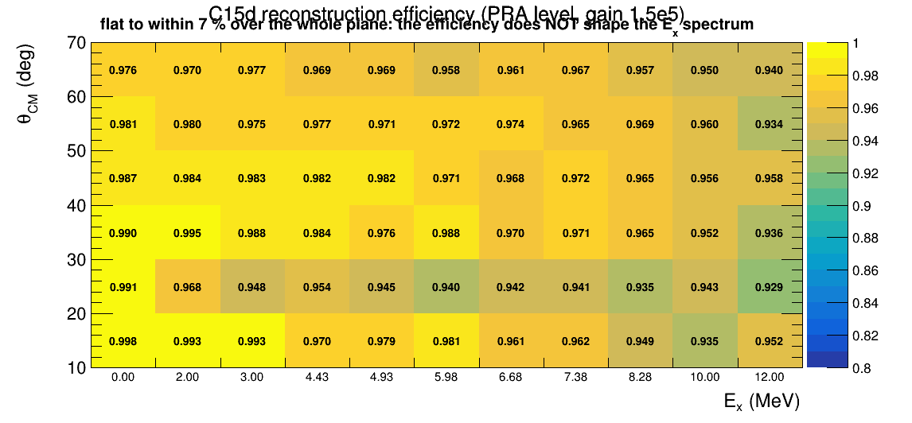

# 15C(d,d') simulation — acceptance and response for `levels_15C`

Why: every open item in `macro/Unpack_HDF5/C15p/levels_15C/LEVELS_15C.md` needs the same missing
ingredient — the **reconstruction** efficiency and the **response function**. The *kinematic*
acceptance is already computed exactly (`levels_15C/scripts/binacc.h`) and is ~1 inside a θ_CM
bin, so geometry is not what is missing.

```bash
source build/config.sh
cd macro/Simulation/ATTPC/C15_dd
# nEvents, thetaCM min/max, engine, B field (kG), output, Ex of the residual, seed, Ebeam
root -b -q 'C15_dd_sim.C(5000, 2., 70., "TGeant4", -28.5, "/home/yassid/Data/C15dd_sim/gs_sim.root", 0.0, 5001, 191.25)'
root -b -q truth.C        # does the analysis formula return the Ex that was generated?
root -b -q ebzscan.C      # what Ebeam(vz) slope minimises the truth-level spread?
```

## Validated so far

**The two-body missing-mass formula returns the generated Ex**, with a `+0.21` MeV offset at
Ex = 0 and `+0.29` at 6.68. That offset is the beam losing energy *before* it reacts
(`maxELoss = 10 MeV`, sampled uniformly, so ~5 MeV on average). It is **not** removable by
`Ebeam(vz)` — `<vz>` = 514 mm sits at the correction's 500 mm pivot, so the correction only takes
out the vz-*dependent* part. The data has the same effect, and the analysis absorbs it by tuning
Ebeam so the g.s. sits at zero: **191.25 is an effective value at the mean vertex, not the
injection energy**. Calibrate the simulation the same way; acceptance and response are both
insensitive to a 0.2 MeV scale offset.

**★ The simulation independently confirms `ebzSlope = 11 MeV/m`.** Scanning the slope and taking
the one that minimises the truth-level Ex spread:

```
slope:      0      2      4      6      8     10     12     14     16     18     20    MeV/m
Ex 0.00  0.183  0.167  0.153  0.143  0.136  0.133  0.135  0.142  0.152  0.166  0.182   rms (MeV)
Ex 6.68  0.192  0.168  0.147  0.129  0.117  0.112  0.115  0.126  0.142  0.163  0.186
```

Minimum at **10 MeV/m at both Ex values independently**, against the 11 MeV/m set empirically on
the data. The correction removes 27-42 % of the truth-level spread.

**The beam-energy spread alone contributes σ ≈ 0.11-0.13 MeV to the Ex resolution**, before any
detector effect. The measured g.s. is FWHM 0.91 (σ ≈ 0.39) for ATTPCROOT, so this is ~10 % of the
variance — real, but not the dominant term.

## Traps

- `FairParRootFileIo` **segfaults** rather than reporting a missing directory if the par file path
  does not exist. The par and geometry files are derived from `outFile` here for that reason.
- `ATTPC_D300torr_r280.root` (used by the a1975 `_r280` macros) is **not** in this repo's
  `geometry/`; use `ATTPC_D300torr_v2.root`, which pairs with the `_geomanager` file the C15d
  reconstruction uses.
- The residual 15C is transported as a **stable ion** even above Sn = 1.218 MeV. Correct for the
  deuteron kinematics, which is all the acceptance is measured on, but this simulation must not be
  used for the neutron or any coincidence.

---

## Reconstruction: `run_reco_C15dd.C`

The chain is copied from the **data**, not from the a1975 simulation: `AtPSAMultiFit` +
`AtTrackFinderTC` (radius 15, distance 7.5), threshold 20, floated peaking time, **no cleaning
task** (the data's PRA reads `AtEventH` directly), par `ATTPC.C15d_a2091_D2.par`. The a1975 macro
this was adapted from uses HDBSCAN, a cleaner, and explicit `SetPeakingTime/MaxPeaks/MinSeparation`
— keeping any of those would measure a different reconstruction's losses.

### ★ The a2091 beam hole is 20 mm — measured, not assumed (`holeR.C`)

`AtBeamHole.h` records that **15C and 16C had never been checked**. Measured its way — hit radius
in data and simulation, each normalised to its own total, take where the ratio goes flat:

```
   r (mm)     data frac    sim frac     sim/data
    2-  4      0.00022     0.14545       670
    4-  6      0.00023     0.13212       562
    6-  8      0.00049     0.04727        96
   10- 20         ...         ...       5-15
   20- 22      0.00145     0.00121      0.84     <- flat from here
   22- 42         ...         ...      0.5-0.9
```

**holeR = 20 mm**, the same as a1975. This also explains why 87 % of electrons are skipped with
the hole on and 12 % with it off: it is the BEAM being inhibited, which is correct.

### ★★ Gain: the par's 10000 is 15x too low (`gainval.C`)

The validation the macro header demands — hits per track against the data production:

```
                         events with a track   tracks/event   hits/track mean / median
DATA run_0017 (mfi)            76.7 %              0.93            148.3 / 130
SIM gain      10000            20.0 %              0.20             56.4 /  46
SIM gain      50000            47.3 %              0.47            103.0 /  81
SIM gain     150000            47.3 %              0.47            139.1 / 128   <- adopted
SIM gain     400000            47.3 %              0.47            171.0 / 167
SIM gain    1000000            47.3 %              0.47            198.5 / 191
```

**Gain = 150000 reproduces the data's hits per track** (139 vs 148 mean, 128 vs 130 median), and
is the same value the (p,d) simulation needed. `ATTPC.C15d_sim_g150000.par` is the file to use;
the data par's 10000 deletes more than half the hits on every track.

⚠ `tracks/event` saturates at 0.47 above gain 5e4 while the data shows 0.93 — these are **not**
comparable: the simulation has exactly one deuteron per event, the data has beam fragments and
other reactions too. The 0.47 is the quantity being measured (the reconstruction efficiency at
Ex = 0 integrated over theta_CM 2-80), not a discrepancy.

### ✓ Field sign agrees with the data (`fieldsign.C`)

The simulation generates at -28.5 kG while the C15d fit is given +2.85 T, so the sense of rotation
had to be checked: if it disagreed, anything inferring direction from curvature would reject most
simulated tracks and the acceptance would measure the sign error. Ordering each track's hits by z
and summing the signed area `x_i*y_{i+1} - x_{i+1}*y_i`:

```
DATA run_0017            3697 tracks    83.7 % clockwise    <signed area> -9.94e+03
DATA run_0021             437 tracks    70.9 % clockwise    <signed area> -5.24e+03
SIM  (field -28.5 kG)      71 tracks   100.0 % clockwise    <signed area> -1.35e+04
```

**Same sense.** The simulation is 100 % because it contains one species from one reaction; the
data is 71-84 % because it is a mixture. The sign is correct as generated.

### ★★★ THE EFFICIENCY IS FLAT — it does not shape the Ex spectrum



11 Ex points x 20k events, reconstructed with the data chain at the validated gain, binned in
TRUE theta_CM:

```
  Ex     N gen   N reco   eff   |   efficiency per theta_CM bin (10-20 ... 60-70)
  0.00    9951    9632   0.968  |  0.998  0.991  0.990  0.987  0.981  0.976
  4.43    9952    9602   0.965  |  0.970  0.954  0.984  0.982  0.977  0.969
  6.68    9956    9553   0.960  |  0.961  0.942  0.970  0.968  0.974  0.961
 10.00    9957    9458   0.950  |  0.935  0.943  0.952  0.956  0.960  0.950
 12.00    2018    1873   0.928  |  0.952  0.929  0.936  0.958  0.934  0.940
```

**0.93 to 1.00 over the whole plane — a 7 % total variation, with no structure.**

⚠ `N gen` is ~9950 of 20000 because **half the generated events never react**: `AtTPCIonGenerator`
samples a threshold uniformly in `[0, maxELoss]` and the beam often leaves before reaching it
(`denom.C`: 10049 of 20000 have no primary deuteron, while theta_CM is valid and vz is inside the
window for *every* event that does). The vertex is flat along the drift length (241-277 per
200 mm slice), which is this generator's own validity requirement. So the denominator is right,
and the earlier "47 % of events have a track" was that 50 % no-reaction fraction times this 96 %.

**Consequences for `levels_15C`, all negative and all useful:**

* the reconstruction efficiency **cannot** explain the continuum shape, the low-energy background,
  or the theta_CM bin 0 degeneracy — it is flat where all three vary strongly;
* combined with the exact kinematic acceptance (`levels_15C/scripts/binacc.h`, also ~1 inside a
  theta_CM bin), **there is essentially no acceptance correction to apply** to the (d,d') spectra;
* so the background really is a property of the data, not of the detector response to it. The
  question of what it *is* stays open, but "it is an efficiency effect" is now excluded.

### ★★ THE RESPONSE: the simulation is ~2x TOO GOOD, and that is itself the result

`response_C15dd.C` forms `Ex_reco - Ex_true` from the AtPIDTask output (the Spyral-like
estimator) and fits it with the same tailed shape used on the data:

```
  Ex      N      bias     FWHM_L  FWHM_R   alpha_L alpha_R
   0.00   9357   +0.379    0.234   0.279     0.30    0.30
   4.43   9390   +0.417    0.615   0.623     0.84    0.82
   6.68   9306   +0.582    0.998   0.308     1.56    0.45
  10.00   9217   +0.748    1.181   0.248     5.60    0.44
  12.00   2153   +0.774    1.206   0.554     3.59    0.87
       DATA:  ATTPCROOT  FWHM 0.752 / 1.142      Spyral  FWHM 0.497 / 0.523
```

At Ex = 0 the simulation gives **sigma = 0.109 MeV against 0.217 measured (Spyral) and 0.402
(ATTPCROOT)** — a factor of two to four too good. The response also becomes strongly asymmetric
with Ex, growing a long LEFT tail (FWHM_L 0.23 -> 1.21 while FWHM_R stays 0.25-0.55).

**What the missing width is NOT**: a beam-energy spread. Ex is insensitive to Ebeam
(`dEx/dEbeam = 0.0155` at theta_lab 75), so supplying it that way would need a spread of
**12-25 MeV, i.e. 6-13 % of 191 MeV** — impossible for a real beam (`missingres.C`).

**What it would be** (`sensit.C`), added in quadrature:

```
 th_lab   dEx/dtheta   dEx/dKE  |  sigma(theta) needed:  ATTPCROOT   Spyral
   65      -0.604      -0.572   |                        0.641 deg   0.310 deg
   75      -0.393      -0.573   |                        0.984 deg   0.475 deg
   85      -0.137      -0.573   |                        2.836 deg   1.370 deg
 or entirely in KE:  sigma(KE) = 12.8 % (ATTPCROOT), 6.2 % (Spyral)
```

sigma(theta) of a few tenths of a degree, or a KE (i.e. Brho) resolution of ~6 %, are ordinary
real-detector numbers — and this simulation has **no electronic noise, no gain non-uniformity and
no calibration error**, which is where that resolution comes from.

⇒ **The simulated response must NOT be used to deconvolve the data.** The response fitted to the
data itself (`levels_15C/scripts/lineshape.C`) remains the right one; the simulation does not
supersede it, and the natural widths stay unmeasured. Closing this needs detector imperfections
in the digitisation, not more statistics.

### Still to do
2. Add detector imperfections (noise, gain spread, calibration error) until the simulated
   resolution matches the measured one — until then the response is not usable.
3. Run the fit stage so the acceptance covers the genfit losses as well, not just the PRA — the
   PRA-level number is an UPPER bound on what the yields actually see.
