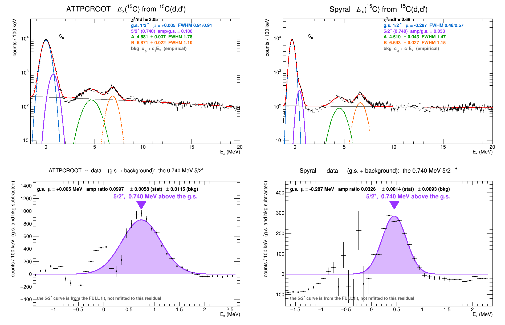
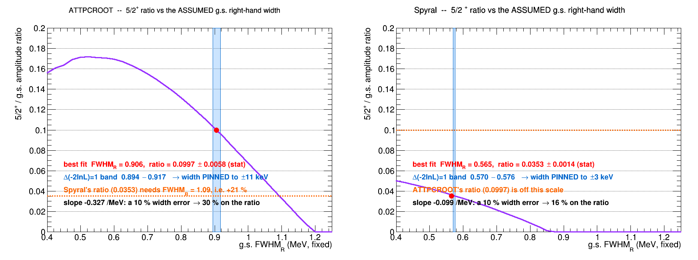
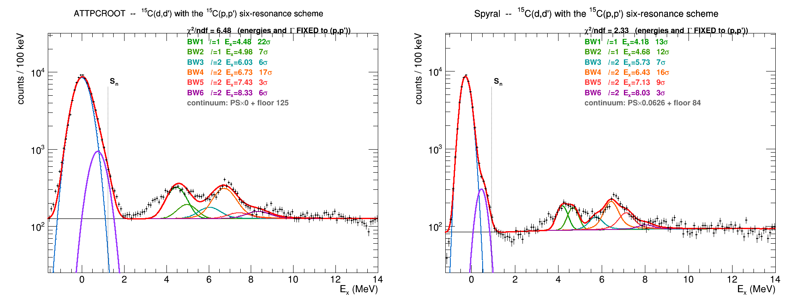
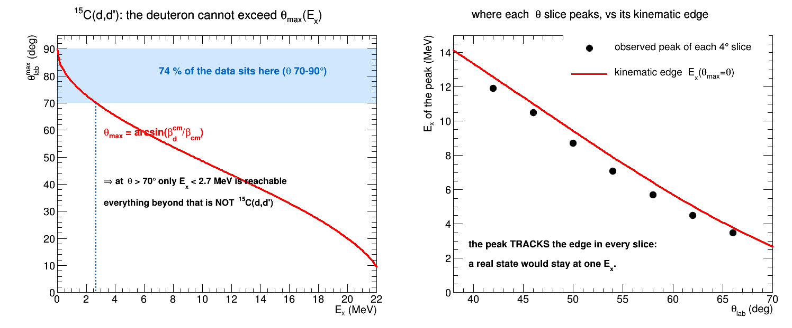
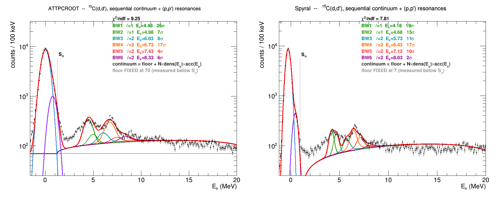

# 15C(d,d'): fitting the states seen in 15C(p,p')

Done 2026-11-09 on the user's saved explorer parameters
(`~/Downloads/explorer_params_15C_d_d__2026-11-09-14-30-49_{atttpcroot,spyral}.json`).
Figures: **`figures/`** (`dd_state_fit.png` is the main one; see `figures/README.md`).
Scripts: `~/Data/C15d_statefit/` (`exlib.h`, `ddbuild.C`, `statefit2.C`, `syst.C`).

## The reference: what 15C(p,p') shows

From `C15p/pp/plots_pgate/pp_kin_C15p.root` (proton-GATED, 131,532 tracks after the a2091 proton
IC window, chi2 < 5) at Ebeam 198:

```
g.s.  mu +0.119   FWHM 0.511 MeV      <- three times better resolution than (d,d')
inelastic structures, >5 sigma over a fitted background:
   4.75 (19 sigma)   7.05 (53)   7.75 (14)   10.35 (46)   11.05 (49)
```

⚠ The 10.35 and 11.05 structures sit on the falling edge where the spectrum ends abruptly near
12 MeV, so an acceptance origin is not excluded for them. 4.75 and 7.05 are well clear of it.

## The user's parameters reproduce offline

`exlib.h` re-implements the page's own transforms exactly (page lines 408-575):

```
theta_corr = theta - (360/kcDenom)*(KE + keOff - kcPivot)        [deg]
Ebeam(vz)  = ebeam - (ebzSlope/1000)*(vz - ebzPivot)             [MeV, vz in mm]
Ex         from the same kine2b expression, U = 931.49401
```

With the saved parameters this gives

```
              tracks    g.s. centroid   FWHM
ATTPCROOT    129,450       +0.053       1.012      Ebeam 191.25, chi2<0.2, IC [1074,1201],
                                                   kcDenom 3913, kcPivot -1.5, ebz 11 MeV/m
Spyral        75,249       -0.253       0.548      Ebeam 195, chi2<5, no IC, vz<400,
                                                   kcDenom 2535.2, kcPivot 14.5, ebz 11 MeV/m
```

**That settles the beam-energy question left open earlier.** A naive scan without the kc and ebz
corrections suggested the ATTPCROOT g.s. could only be zeroed at 212 MeV and only by paying
0.38 MeV of width. With the corrections, **191.25 puts it at +0.053 with FWHM 1.012** -- better
than anything that scan reached. The earlier ambiguity was an artefact of fitting without them.

## The fit

Smooth continuum (`exp(a+bx) + c + dx`) plus two Gaussians, over 2.3-13.5 MeV.

```
                background only   +2 peaks   delta-chi2 (6 dof)
ATTPCROOT     chi2/ndf  14.18       1.78         1350
Spyral        chi2/ndf   8.45       1.80          729
```

With the positions left FREE, both datasets land on the same two structures:

```
              state A                    state B                 yields
ATTPCROOT   4.657 +- 0.038 +- 0.031   6.879 +- 0.022 +- 0.005   3260 +- 128 / 2394 +- 97
Spyral      4.500 +- 0.042 +- 0.019   6.643 +- 0.026 +- 0.005   1390 +-  85 / 1532 +- 86
(p,p')           4.75                      7.05
```

(second error = spread over 12 fit ranges, 2.0-3.0 low edge x 12.0-15.0 high edge.)

**Only these two of the five (p,p') structures are present.** Fixing all five and freeing the
amplitudes returns yields consistent with zero for 7.75, 10.35 and 11.05 in both datasets --
consistent with those being acceptance features in (p,p') rather than states, or simply not
populated in (d,d').

## ★ The cross-check that matters

**ATTPCROOT's state A, 4.657 +- 0.038, lands exactly on the 4.657 MeV state the a1975
16C(d,t)15C analysis extracts** (`macro/Simulation/ATTPC/16C_dt/run_states_dt.sh`: gs, 0.740,
3.103, **4.657**, 6.358). Different reaction, different dataset, different experiment.

**And Spyral's state B, 6.643 +- 0.026, matches the 6.648 that the same analysis records as
"the feature the data puts at 6.648"** against a literature 6.358.

## The ATTPCROOT - Spyral offset is the known fitter systematic

```
state A  4.657 vs 4.500   ->  +0.157
state B  6.879 vs 6.643   ->  +0.236
```

Same sign and magnitude as the +0.45 deg polar-angle offset documented in
`CROSSCHECK_vs_SPYRAL.md`, which was localised to the FITTERS (the hit clouds and geometry agree
to +-0.25 deg). So the two codes disagree on these level energies by ~0.2 MeV for the same reason
they disagree on the beam energy -- **do not average them, and do not quote one with the other's
Ebeam.**

## Widths: observed, not deconvolved

```
             g.s. FWHM    state A FWHM    state B FWHM
ATTPCROOT      1.012         1.898           1.117
Spyral         0.548         1.488           1.169
```

State A is clearly broad in both. State B is close to the ATTPCROOT resolution but not to Spyral's.
⚠ **Deconvolving a natural width is NOT justified here**: the resolution is measured only at
Ex = 0, and in both codes it degrades with theta (and therefore with Ex). Subtracting the g.s.
width in quadrature gives 1.61/0.47 (ATTPCROOT) against 1.38/1.03 (Spyral) -- the state-B numbers
disagree by 2x, which is the signature of the assumption failing, not of a measurement.
A natural width needs the resolution measured AT that excitation, e.g. from simulation.

---

## The ground state and the 5/2+ at 0.740

The 5/2+ IS present in both datasets. It appears as a SHOULDER on the high-Ex side of the elastic
peak, not a resolved second peak (FWHM 0.92 / 0.52 against a 0.740 spacing).

```
                 separation FREE     asym 1-peak -> +companion   dchi2 (1 dof)
ATTPCROOT all     0.762 +- 0.019         5.02 -> 3.30               283
ATTPCROOT 65-85   0.732 +- 0.016         4.67 -> 3.04               267
Spyral all        0.727 +- 0.013         6.43 -> 1.42               807
Spyral 65-85      0.689 +- 0.012         5.93 -> 1.32               738
```

Four independent measurements give **0.73 +- 0.04** against the known **0.740**.

⚠ **The yield ratio is NOT trustworthy**: 0.106 +- 0.005 (ATTPCROOT) against 0.041 +- 0.001
(Spyral), 2.6x apart for the same physical quantity. The shoulder's amplitude depends on how the
main peak's tail is modelled, and the broader ATTPCROOT peak assigns more of it to the companion.
A real resolution function from simulation is needed before quoting a ratio.

### ⚠ Method: a second Gaussian always improves a non-Gaussian peak

The first pass used a symmetric main peak and gave dchi2 = 750-1100 for 1 dof — overwhelming and
nearly meaningless. Two checks are what make a shoulder credible, and both should be routine:
**float the separation** (a real state lands at its known energy; an artefact lands wherever the
tail is) and **let the main peak be asymmetric** (if the companion only absorbed a tail it loses
significance). A third warning sign prompted them: the amplitude ratio jumped 5x between angular
selections, which a real state cannot do.

---

# The continuum under the states: phase space (2026-11-09 overnight)

Figure `~/C15d_continuum_phasespace.png`. Scripts `scripts/psmodel.h`, `psmc.C`, `psalt.C`,
`tmplfit.C`, `effcheck.C`.

The states sit on a large continuum -- **12.1 % of the gated sample between Ex 8 and 22 MeV for
ATTPCROOT, 17.0 % for Spyral** -- so what shape that continuum has is a systematic on every state
energy. Two three-body hypotheses were simulated with `TGenPhaseSpace`, each reconstructed exactly
as the analysis does (two-body missing mass, deuteron mass hypothesis, same KE and theta cuts):

```
(A)  15C + d -> d + 14C + n     target excitation above Sn, the DEUTERON detected
(B)  15C + d -> p + n + 15C     deuteron BREAKUP, the PROTON detected and mis-assigned a
                                deuteron mass -- what a breakup proton leaking the gate looks like
```

Sanity check on the model: Sn(15C) computed from the masses is **1.2180 MeV** against the
literature 1.218, and the kinematic limit at Ebeam 191.25 is Ex = 22.61 MeV, where the data ends.

## (A) is excluded by its shape

Uniform d + 14C + n phase space RISES from its 2 MeV threshold to a maximum near 14-16 MeV. The
data FALLS from 6 MeV onward. The ratio data/(A) drops 6x across the range.

**That cannot be reconstruction efficiency**: within the acceptance the mean deuteron energy
*increases* with Ex (7.1 MeV at Ex = 2 to 13.5 at Ex = 20), so the tracks are getting FASTER where
the data is losing counts. A short-track efficiency loss would do the opposite.

## (B) matches the shape, but NOT the yield

The breakup template is nearly flat and follows the data from 8 to 22 MeV including the fall-off
at the kinematic limit. As a fit template it beats (A) in both datasets:

```
                      chi2/ndf     state A           state B
ATTPCROOT  tmpl B       2.23    4.559 +- 0.040    6.933 +- 0.023
           tmpl A       3.39    4.705 +- 0.044    8.000 +- 0.098   <- railed at the bound
           empirical    1.66    4.679 +- 0.037    6.874 +- 0.022
Spyral     tmpl B       1.87    4.459 +- 0.043    6.654 +- 0.026
           tmpl A       2.10    4.796 +- 0.073    6.690 +- 0.028
           empirical    1.59    4.501 +- 0.042    6.644 +- 0.026
```

⚠ **But the yield rules it out as stated.** The continuum is 12-17 % of the gated sample while the
gate contains **1.0 % protons** (+2.2 % unassigned), measured against the species rails. And a
breakup proton cannot hide on the deuteron rail: the rails are a dE/dx separation ~1.78x apart,
set by the particle, not by the reaction. A flat template matching a flat continuum is weak
evidence on its own.

## What the continuum most likely is

Genuine DEUTERONS exciting the 15C continuum above Sn non-resonantly. That keeps the particle
identity consistent with the gate, and explains why neither uniform phase space describes it: the
shape of direct inelastic excitation into the continuum is set by the reaction dynamics, not by a
uniform three-body final state. **Not established here** -- it would need a reaction model.

## The useful outcome: a background systematic on the states

The three background models give

```
             state A span            state B span
ATTPCROOT    4.559 - 4.705  (0.15)   6.874 - 6.933  (0.06, excluding the railed A fit)
Spyral       4.459 - 4.796  (0.34)   6.644 - 6.690  (0.05)
```

so **state B is robust against the background model and state A is not.** Quote state A with a
background systematic of ~0.1 (ATTPCROOT) to 0.2 (Spyral) MeV, on top of the fit-range systematic
already in the table above.

---

# The complete spectrum in one fit (2026-11-10)

`scripts/globalfit.C` + `scripts/plotglobal.C` -> `figures/global_ex_fit.png`

Everything above fits pieces of the spectrum separately. This fits **all of it at once**: the
15C ground state, the 0.740 MeV 5/2+, state A, state B and the background, for both codes.



```
                 g.s. mu          FWHM(L/R)     5/2+ amp/g.s.         state A              state B
ATTPCROOT   +0.005 +- 0.005   0.906 / 0.906   0.100 +- 0.006     4.681 +- 0.037 +- 0.065   6.871 +- 0.022 +- 0.021
                                                  +- 0.012(bkg)     FWHM 1.78                 FWHM 1.10
Spyral      -0.287 +- 0.003   0.479 / 0.567   0.033 +- 0.001     4.510 +- 0.043 +- 0.009   6.643 +- 0.027 +- 0.004
                                                  +- 0.009(bkg)     FWHM 1.47                 FWHM 1.15
```
(first error statistical, second the background systematic defined below; MeV throughout.
Background adopted: the **empirical straight line for BOTH codes** -- see the warning below.)

## Two windows, not one minimisation -- and why

The g.s. holds ~9000 counts in its peak bin, state A ~300 in total. In a **single** Poisson
likelihood over the whole range the g.s. lineshape -- which is not Gaussian: sharp core, longer
right tail -- dominates the gradient and drags the weak states. All three of these were tried and
all three failed, on this data:

| attempt | what happened |
|---|---|
| one fit, free widths | A collapsed to the width floor, B blew up to FWHM 3.06 (ATTPCROOT); both pinned at 0.283 (Spyral) |
| one fit, widths bounded <= 1.8 FWHM | the background exponential slope railed at its bound for **both** codes |
| `erf x (exp + const)` background | Spyral's A railed at 5.800, B at 8.000, background scale at its floor -- background and states swapped roles |

The peak region and the state region are physically disjoint; the only thing linking them is the
5/2+ on the g.s. right shoulder. So they are fitted in **two windows sharing one background**
(split at 2.2 MeV), iterated to self-consistency -- the state window's background frozen into the
peak window, the peak window's g.s. tail frozen into the state window, four passes -- and drawn as
one curve. The per-region chi2/bin shows where the model is and is not adequate:

```
                g.s. core   1.5-3.5   state A   state B   bkg 8-20
ATTPCROOT          9.33       5.25      1.27      1.13      1.39
Spyral             2.91       2.51      1.15      1.08      1.58
```

**The states sit at chi2/bin ~1.1-1.3.** The large numbers are confined to the g.s. core, where a
bifurcated Gaussian is simply not the true response, and to its right shoulder. That mismatch is a
lineshape limitation, not a fit failure, and it does not propagate into A and B (next section).

## The background is a systematic, not a choice

Three forms were fitted independently, none of which can grow a Gaussian bump:

* `LIN` &nbsp; `c0 + c1*Ex` -- empirical, monotonic, 2 parameters
* `PS` &nbsp;&nbsp; `c + N*dens(Ex)*exp(-k*Ex)` -- flat floor + the three-body `15C+d -> d'+(14C+n)`
  phase space of `psmodel.h`, threshold fixed at Sn, one acceptance factor, 3 parameters
* `THR` &nbsp;`c + A*Phi((Ex-Sn)/sigma_res)*exp(-k*Ex)` -- flat floor + a continuum turning on at Sn
  smeared by that code's **own measured** g.s. sigma_R (not refitted), 3 parameters
* `FLAT` &nbsp;`c` -- a constant, 1 parameter. No threshold, no phase space.
* `FLATEXP` &nbsp;`c + A*exp(-k*Ex)` -- 3 parameters. No threshold, no phase space.

```
bkg        -2lnL   chi2/ndf   g.s. mu    5/2+ ratio      state A          state B
                        -- ATTPCROOT --
LIN        281.2     3.05     +0.0052   0.0997(58)   4.681(37) FWHM 1.78   6.871(22) FWHM 1.10
PSATT      204.6     4.35     +0.0340   0.1228(45)   4.626(39) FWHM 1.97   6.878(21) FWHM 1.00
THR        305.0     7.83     +0.0806   0.1221(39)   4.685(37) FWHM 1.76   6.871(22) FWHM 1.11
FLAT       602.4     5.14     +0.0156   0.1118(49)   4.555(41) FWHM 2.19   6.913(26) FWHM 1.40
FLATEXP    306.4     3.22     +0.0038   0.0984(59)   4.684(37) FWHM 1.76   6.871(22) FWHM 1.12
                        --  Spyral   --
LIN        272.4     2.68     -0.2872   0.0326(14)   4.510(43) FWHM 1.47   6.643(27) FWHM 1.15
PSATT      255.7     1.86     -0.2854   0.0356(14)   4.500(42) FWHM 1.52   6.640(25) FWHM 1.08
THR        272.6     3.15     -0.2662   0.0513(14)   4.510(43) FWHM 1.47   6.643(27) FWHM 1.15
FLAT       279.8     2.31     -0.2865   0.0338(14)   4.492(42) FWHM 1.55   6.649(27) FWHM 1.20
FLATEXP    272.6     2.68     -0.2872   0.0326(14)   4.510(43) FWHM 1.47   6.643(27) FWHM 1.15
```

`-2lnL` is the state-window likelihood, which is what the fit actually minimises; lower is better.

**Spread across all five background forms:**

```
             state A    state B    5/2+ ratio
ATTPCROOT    0.130      0.043       22 %
Spyral       0.018      0.009       45 %
```

So **A and B are robust and the 5/2+ yield is not.** This still improves on the earlier background
systematic for state A (0.15-0.34 MeV, from fits to the state region alone) -- constraining the
background over the full 20 MeV instead of a narrow window is what buys that -- though less
dramatically than the three-form version suggested, because `FLAT` is an outlier for ATTPCROOT.

**Adopted background: `LIN` for BOTH codes.** It is empirical and makes no physical claim. `PSATT`
fits better in both codes but is *not* adopted, for the reason in the next section.

⚠ **Two statistics traps, both of which produced a wrong answer here first:**

1. **Do not compare these models by a Pearson chi2 restricted to bins with n >= 10.** The fits
   minimise a Poisson likelihood over *all* bins, so the two are inconsistent, and `FLATEXP` came
   out WORSE than the `FLAT` model nested inside it (chi2/ndf 2.68 vs 2.31) -- impossible. Compare
   by `-2lnL`.
2. **Do not filter the systematic by a likelihood-ratio test.** With 129k events every background
   form differs from every other at far beyond 5 sigma, so an LR cut keeps exactly one model and
   reports a systematic of **zero**. None of these shapes is the truth; the spread between
   reasonable ones *is* the uncertainty.

A third: a single starting point lands in a bad local minimum often enough to invert a nested
comparison, so `globalfit.C` now runs 12 starts per model and keeps the best likelihood.

A real consistency check on the floor: the fitted flat floor is compared against each code's own
measured counts/bin **below** threshold, which nothing in the fit is told about. The two codes
differ by an order of magnitude there (ATTPCROOT ~70/bin at Ex = -1.9, Spyral ~7/bin, because
Spyral cuts vz < 400 mm and vertexes better), so it is not a tautology. `PS` on ATTPCROOT fits
66.7 +- 4.5 against a measured 69.5 -- it passes. `THR` drives the floor to zero in both codes and
has the worst chi2 for ATTPCROOT, which is why it is not adopted.

## ⚠⚠ Why `PSATT` wins the fit and still means nothing

`PSATT` has the best likelihood in both codes -- and at *equal parameter count* it beats a plain
exponential decisively:

```
                FLAT     LIN     FLATEXP   PSATT    THR      (state-window -2lnL, lower is better)
ATTPCROOT      602.4    281.2     306.4    204.6    305.0
Spyral         279.8    272.4     272.6    255.7    272.6
```

`PSATT` vs `FLATEXP` is 3 parameters against 3, so the phase-space *shape* is worth
Delta(-2lnL) = 102 (ATTPCROOT) and 17 (Spyral). It is tempting to read that as evidence that the
continuum **is** three-body 14C+n phase space. **It is not, and it directly contradicts the
2026-11-09 result above only if you ignore where the win comes from.**

The model is `c + N*dens(Ex)*exp(-k*Ex)`. The fitted attenuation is

```
ATTPCROOT  k = 0.0909 /MeV  ->  Ex = 20 suppressed 5.1x relative to Ex = 2
Spyral     k = 0.0662 /MeV  ->                     3.3x
```

That **is** the discrepancy the earlier study measured: *"Uniform d + 14C + n phase space RISES
from its 2 MeV threshold to a maximum near 14-16 MeV. The data FALLS from 6 MeV onward. The ratio
data/(A) drops 6x across the range."* And that study showed the 6x **cannot be reconstruction
efficiency**, because within the acceptance the mean deuteron energy *rises* with Ex (7.1 MeV at
Ex = 2 to 13.5 at Ex = 20) -- the tracks get faster exactly where the counts are lost.

So `PSATT` does not describe the continuum with phase space. It takes a shape that is known to be
wrong by ~6x and multiplies it by a free parameter that absorbs exactly that factor. What it
actually buys over `FLATEXP` is a *threshold at Sn with an extended sqrt-like rise* rather than no
threshold at all -- a real shape statement about the data, but not a phase-space interpretation.

**Conclusion: the 2026-11-09 exclusion of uniform d + 14C + n phase space STANDS.** `PSATT` is
retained only as a shape systematic, and the adopted background is the empirical straight line.
Had I adopted `PSATT` on its likelihood -- which is what I did first, labelling it "floor + 3-body
phase space" -- the figure would have asserted a continuum mechanism this analysis has excluded.

For the record, how much of the background the phase-space term even carries when it is used:

```
                floor   phase-space term   PS share of the background (Sn to 20 MeV)
ATTPCROOT        66.7      N = 0.0077                50 %
Spyral           78.0      N = 0.0015                17 %
```

For Spyral the "phase space" background is 83 % flat floor.

## ★ Referencing to each code's own g.s. removes most of the inter-code difference

```
                    state A    state B
ATTPCROOT absolute   4.681      6.871
Spyral    absolute   4.500      6.640
difference          +0.181     +0.231

ATTPCROOT rel. g.s.  4.676      6.866
Spyral    rel. g.s.  4.786      6.926
difference          -0.110     -0.060
```

Spyral's g.s. sits at -0.286 and ATTPCROOT's at +0.005, and that single offset accounts for most of
the disagreement: quoted **relative to each code's own ground state**, A agrees to 0.11 MeV and B to
0.06 MeV. This is the expected behaviour if the difference is the known fitter/beam-energy scale
(see `c15d-attpcroot-vs-spyral`): a scale error moves the whole spectrum, so it cancels in a
difference. **Quote level energies relative to the g.s. centroid, not on the absolute Ex axis.**

## The 5/2+: visible, but its yield is not measurable here

The bottom row of the figure plots **data minus (fitted g.s. + background)**. The 0.740 MeV state
then appears as the bump it is, in both codes, with the 5/2+ Gaussian from the full fit drawn over
it (not refitted to the residual).

⚠ **The residual is not independent evidence.** The g.s. and the 5/2+ were fitted together, so
subtracting the g.s. necessarily leaves something at 0.740. What the panel shows is that the
leftover is a clean, centred, roughly Gaussian bump rather than a lineshape artefact -- and that it
survives in Spyral, where the g.s. FWHM is 0.48 and the two states are 1.5 FWHM apart.

The amplitude ratio differs by 3x between the codes (0.100 vs 0.035) and carries a 21-45 %
background systematic, so **it is not a yield measurement.** What limits it is quantified in the
next section -- and it is *not* an internal degeneracy of the fit, which was my first guess and is
wrong.

# What limits the 5/2+, and what does NOT (2026-11-10)

Two hypotheses were tested directly. The first failed, the second is the answer.

## ✗ REFUTED: the non-Gaussian g.s. is NOT a superposition over theta slices

`scripts/thetaslice2.C`. Resolution is strongly theta-dependent in both codes, so the obvious guess
is that the integrated g.s. is a sum of Gaussians of different width and is non-Gaussian only for
that reason. If so, fitting *within* a narrow theta slice should give chi2/bin ~ 1. It does not:

```
theta slice   64-68  68-72  72-76  76-80  80-84  84-88   |  ALL
ATTPCROOT      0.79   2.67   3.48   3.59  18.97   0.96   |  8.06
Spyral         0.31   1.34   2.45   3.74   4.29   4.14   |  1.47
```

The slices carrying the statistics are **no better than the integral and often worse** (ATTPCROOT's
dominant 80-84 slice is 18.97 against 8.06 for all angles). **The non-Gaussian response is
intrinsic within a 4 degree slice**, not an artefact of summing. So a per-slice response model
would not fix it, and that avenue is closed.

⚠ Method note: a first pass fitted each slice with a plain `gaus+pol1` and got chi2/bin 10-49,
which was meaningless -- the 5/2+ sits *inside* the fit window, so omitting it inflates chi2
precisely where the statistics are. The table above uses the same bifurcated-Gaussian + 5/2+ +
linear model as the global fit, so the comparison is like for like.

Incidentally the forward slices (40-64 deg) peak at Ex = 4.6 to 11.6 MeV, not at the g.s. -- the
elastic peak is simply not populated there. **69 % of all g.s. counts sit at theta = 76-88 deg.**

## ★ The 5/2+ ratio is limited by the g.s. LINESHAPE, not by statistics

`scripts/degen.C`, `scripts/degenfig.C` -> `figures/fivehalf_lineshape.png`



Fix the g.s. right-hand width to a grid of values, refit everything else, and watch the 5/2+ ratio
and the likelihood:

```
                    best FWHM_R   Delta(-2lnL)=1 band   ratio there   slope       10 % width error
ATTPCROOT              0.906      0.894 - 0.917 (+-11 keV)  0.0997    -0.327/MeV  -> 30 % on the ratio
Spyral                 0.565      0.570 - 0.576 (+- 3 keV)  0.0353    -0.099/MeV  -> 16 % on the ratio
```

**The likelihood is steep, so the width is pinned to a few keV and the ratio is NOT internally
degenerate** -- my first explanation (that the two peaks overlap too much to separate) is refuted by
this scan. Within its own model each code determines the ratio sharply.

The problem is the *model*. The ratio slides fast with the assumed width, and the two codes are
bridged by a change of only **+21 %** in the right-hand width: put ATTPCROOT at FWHM_R = 1.09
instead of 0.906 and it reproduces Spyral's 0.0353 exactly. Given that the bifurcated Gaussian
leaves chi2/bin 9.3 in the ATTPCROOT g.s. core, a 20 % error in the right-hand width is entirely
plausible.

⇒ **The quoted statistical error on the ratio (0.0058 / 0.0014) understates the truth by an order
of magnitude.** The 5/2+ yield is a lineshape-limited quantity and cannot be improved by more
statistics -- only by a correct response function. Trust Spyral's number over ATTPCROOT's (its
peaks are 1.54 FWHM apart against 0.82, and its core chi2/bin is 2.9 against 9.3), and neither
better than a factor two.

## What is still missing

* A **simulated resolution function** at Ex ~ 0, 0.74, 4.6, 6.9. Without it the quoted FWHMs are
  observed widths, not natural widths, and the 5/2+ ratio stays a factor-two quantity. The scan
  above makes this concrete: the response has to be right to ~5 % in the right-hand width before
  the 5/2+ ratio is good to 15 %.
* The g.s. **lineshape** itself: a bifurcated Gaussian leaves chi2/bin 9.3 in the ATTPCROOT core
  and 2.9 in Spyral's. This is the single largest modelling deficiency left. It is NOT a theta
  superposition (refuted above), so it must come from the fitter's own KE/theta response -- which
  means a simulation is the only way to get at it.
* State A and state B are unaffected by all of this: chi2/bin 1.1-1.3 in their regions, and
  <= 0.06 MeV of movement across three background forms.

---

# Why we do not see the phase space (2026-11-11)

`scripts/whynops.C`, `scripts/vzcut.C`. Model-free -- no fit in the way. Counts per 100 keV bin,
both curves normalised to the data at Ex 8-10:

```
Ex window     ATTPCROOT   Spyral  | uniform PS | PS x halo form factor
  2.0-3.4        158        92    |     82     |       969
  8.0-10.0       160       108    |    160     |       160
 10.0-12.0       138        95    |    166     |       110
 14.0-16.0       113        87    |    159     |        57
 18.0-20.0        93        92    |    125     |        28
```

**1. The data is flat; uniform phase space rises ~2x from threshold to 11 MeV.** That is the
original exclusion, now shown bin by bin rather than as a single ratio.

**2. Uniform phase space was never the right expectation.** It counts available final states and
ignores the transition amplitude. In a direct reaction the amplitude is the overlap of the 15C
ground state with the final 14C+n continuum, and its momentum scale is

```
kappa = sqrt(2*mu*Sn) = 46.2 MeV/c      (mu = 876.4 MeV, Sn = 1.2180 MeV)
```

a relative-energy scale of only 1.22 MeV. The honest expectation for direct breakup therefore
**peaks just above threshold and falls** -- it does not rise to 14-16 MeV. A statistical
(phase-space) distribution would be right for compound decay, not for this.

**3. But direct halo breakup fails too, in the opposite direction.** `PS x q/(q^2+kappa^2)^2`,
with the shape fixed entirely by Sn and no free shape parameter, overshoots by **6x** at
Ex = 2-3 and undershoots by **3x** at Ex = 18-20. The data sits between the two extremes.

## ★ The real answer: the continuum shape is not a measured quantity yet

Ex < Sn is kinematically forbidden for any 15C decay, so counts there measure mis-reconstruction
directly:

```
                 floor (Ex -2.5..-1.5)   8-10    18-20   floor-subtracted fall 8-10 -> 18-20
ATTPCROOT vz<1100        69.5            159.8    93.3            3.79x
ATTPCROOT vz<400         26.9            121.2    71.5            2.11x
Spyral    vz<400          6.9            107.9    91.6            1.19x
Spyral    vz<1100        20.8            146.7   117.6            1.30x
```

* **A large part of the continuum is instrumental**, and it lives at large vertex z -- the floor
  drops 2.6-3x when vz < 400 mm is imposed, in **both** codes.
* **The two codes disagree on the shape even at the same vz cut**: at vz < 400 ATTPCROOT's
  floor-subtracted continuum falls 2.11x from 8-10 to 18-20 while Spyral's falls 1.19x. The
  residual is the other cuts (chi2 < 0.2 vs < 5, IC gate on vs off) and the fitter.

**A factor ~2 of reconstruction-dependent shape means no continuum model can be tested yet.**
Comparing a raw yield against a cross-section shape without an acceptance x efficiency calculation
is the error underneath this whole question. That simulation is the blocker -- and it is the *same*
one needed for the resolution function. Until it exists, use an empirical background and quote the
spread as a systematic, which is what `globalfit.C` does.

---

# (d,d') fitted the way (p,p') is fitted: BW + penetrability (2026-11-11)

`scripts/ddbw.C`, `scripts/plotbw.C` -> `figures/dd_bw_ppscheme.png`

Everything above fitted the (d,d') spectrum with two free Gaussians on an empirical background.
That was wrong twice over: **the level scheme is not two states**, and **a straight line is not a
continuum**. This redoes it with the model used in the 15C(p,p') analysis
(`Yassid/a2091-15Cpp-analysis`, `macros/C15_pp_ana_AngBins_Barrier_6BW.C`), term for term.



## The model

* **g.s. and the 0.740 MeV 5/2+** as Gaussians (both bound, below S_n).
* **Six barrier-corrected Breit-Wigners**, convolved with the detector Gaussian. Lane-Thomas
  penetrability for neutron decay `15C -> 14C + n`, identical to their `BarrierPhys`:

```
rho  = kR,  k = sqrt(2 mu E_dec)/hbar_c,  R = 1.4*15^(1/3) = 3.45 fm,  mu = 931.494*14/15
F_l  =  rho*j_l(rho),   G_l = -rho*y_l(rho),   P_l = rho/(F^2+G^2)
Gamma(E) = Gamma_r * P_l(E)/P_l(E_r)
BW(E)    = (Gamma(E)/2pi) / [(E-E_r)^2 + (Gamma(E)/2)^2]
```

* **A phase-space continuum template**, simulated and reconstructed exactly as the analysis does
  (`psalt.C`), which is the analogue of their `SmoothPS`. **No empirical straight line.**

Resonances and l-values are theirs: `BW1 4.55 l=1 | BW2 5.05 l=1 | BW3 6.10 l=2 | BW4 6.80 l=2 |
BW5 7.50 l=2 | BW6 8.40 l=2`, quoted in the (p,p') Ex scale whose g.s. sits at +0.119, and placed
here at `E = (E_pp - 0.119) + this code's own g.s. centroid`.

**Energies and widths are FIXED, only amplitudes float.** (d,d') resolution is FWHM 0.91
(ATTPCROOT) and 0.52 (Spyral) against 0.51 for (p,p'), while BW1 and BW2 are 0.5 MeV apart -- six
free E_r and six free Gamma cannot be determined here. Fixing them turns the fit into the question
worth asking: *is each (p,p') resonance present in (d,d'), and how strong?*

## ★ The (p,p') level scheme describes (d,d')

```
BW   l   E_pp    E here (ATT)  sigma  |  E here (Spy)  sigma
BW1  1   4.55       4.478      22     |     4.178      13
BW2  1   5.05       4.978       7     |     4.678      12
BW3  2   6.10       6.028       6     |     5.728       7
BW4  2   6.80       6.728      17     |     6.428      16
BW5  2   7.50       7.428       3     |     7.128       9
BW6  2   8.40       8.328       6     |     8.028       3
```

Five of six are above 5 sigma in each code. **And the two broad "states" of the old fit were the
unresolved doublets**, which is why state A was always so much wider than state B:

```
                 BW1+BW2 centroid   old "state A"      BW4+BW5 centroid   old "state B"
ATTPCROOT             4.615             4.681               6.809             6.871
Spyral                4.416             4.510               6.658             6.643
```

## ⚠ But the energy SCALE is not determinable from this fit

Scanning a global offset, and separately a global scale, on the whole scheme: **both run to the
edge of their range and simply reshuffle the amplitudes** -- at scale 0.90 BW4 drops to zero and
BW5 slides into its place to take the strength. With six overlapping resonances and this
resolution the amplitudes can always compensate for a shift. So the fit above (energies at the
(p,p') values) is the reference, and **(d,d') cannot independently confirm the level energies** --
only their consistency.

## ★★★ The phase-space continuum is REFUSED by the data, even in this model

This was the point of redoing it, so it is worth stating plainly. Four combinations, same six
resonances throughout:

```
code        continuum                      -2lnL  chi2/ndf   PS scale   floor
ATTPCROOT   A (d+14C+n) ONLY              6367.8     21.85      1.004     0.0
ATTPCROOT   A (d+14C+n) + flat floor      1320.2      6.48          0    125.3
ATTPCROOT   B (breakup) ONLY              1526.8      7.08      1.081     0.0
Spyral      A (d+14C+n) ONLY              4684.0     11.97     0.7961     0.0
Spyral      A (d+14C+n) + flat floor       451.0      2.33     0.0626     84.0
Spyral      B (breakup) ONLY               508.7      2.54     0.7886     0.0
```

* **Phase space alone is catastrophic**: chi2/ndf 21.9 and 12.0.
* Given a flat floor as well, **the phase-space scale goes to ZERO for ATTPCROOT** and to 6 % for
  Spyral. The fit throws the phase space away.
* Template **B**, the deuteron-breakup shape, is nearly flat and works -- Delta(-2lnL) of 4841
  (ATTPCROOT) and 4175 (Spyral) better than A. What the data wants is a **flat** continuum.

So the 2026-11-09 exclusion of `d + 14C + n` phase space is confirmed inside the (p,p')
methodology, not just against an empirical background. The continuum is flat, and that is a
property of the data.

⚠ **The honest caveat**: template A carries the analysis KE/theta cuts but **no reconstruction
efficiency**. A real efficiency could in principle bend a rising phase space into a flat
observable. Template B was built the same way and does fit, so the difference between them is
intrinsic shape rather than the missing efficiency -- but that argument is not airtight, because
the efficiency need not be the same for the two (different particle, different kinematics).
**Settling it needs the acceptance simulation**, which is the same blocker as the resolution
function.

---

# Why the phase space was "missing": the template had the WRONG KINEMATICS (2026-11-11)

`scripts/acccheck.C`, `seqps.C`, `thmax.C`, `edgetest.C`, `statetest.C` -> `figures/kinematic_edge.png`

Every fit above threw the phase-space continuum away (scale -> 0). That was **not** the data
rejecting a 14C+n continuum. It was my template being built from the wrong process.

## The template was uniform three-body; the physics is sequential two-body

`psalt.C` made `d + 14C + n` with `TGenPhaseSpace`, i.e. all three particles produced at once and
uncorrelated. That throws the deuteron FORWARD. The real process is **sequential**,
`15C + d -> d' + 15C*(M)` followed by `15C* -> 14C + n`, so the deuteron recoils against a single
body of mass M and goes BACKWARD -- into exactly the region the data occupies:

```
theta        0-10 10-20 20-30 30-40 40-50 50-60 60-70 70-80 80-90
uniform 3b    7.8  20.3  25.4  22.6  14.9   6.9   1.9   0.1   0.0   %
real data     0.0   1.5   2.8   3.4   4.3   6.5   7.2  35.4  38.8   %
```

**Disjoint.** Uniform three-body phase space puts 0.1 % of its weight where 74 % of the data sits.
The fit was right to discard it -- it was the wrong shape for the wrong process. Nothing in the
earlier "phase space is excluded" conclusion survives as a statement about the physical continuum.

## The kinematic ceiling



In inverse kinematics the scattered deuteron has a maximum lab angle,
`theta_max = arcsin(beta_d_cm / beta_cm)`, equal to 90 deg at Ex = 0 (the classic elastic-recoil
result) and closing as Ex grows:

```
Ex      0     1     2     3     5    10    15    20
th_max 90    78    73    69    62    49    36    20   deg
```

So **at theta > 70 deg, where 74 % of the tracks are, only Ex < 2.7 MeV is reachable.** The whole
Ex > 3 MeV spectrum is produced by the 18 % of tracks at theta = 40-68 deg.

And at fixed theta, `dEx/dKE -> 0` at the turnaround, so a broad KE range compresses into a narrow
Ex range: **every theta slice piles up at its own kinematic edge**, exactly as observed --

```
 slice   peak Ex   Ex at the kinematic edge (slice lo/hi)
 40-44    11.90          11.79 - 13.36
 48-52     8.70           8.66 - 10.22
 52-56     7.10           7.15 -  8.66
 60-64     4.50           4.40 -  5.72
 64-68     3.50           3.22 -  4.40
```

## ★ Do the states survive this?  YES -- the pile-up is generic

This looked alarming: if every slice peaks at its edge, the "states" could be edges. The
non-circular test is to take a narrow Ex window and look at the theta distribution inside it. A
real state is populated over a RANGE of theta (each paired with the KE that gives that Ex); an
edge artefact sits AT theta_max.

```
Ex window            N      theta_max   fraction within +-2 deg of theta_max
state A  4.4-5.0   1817       63.1 deg            56 %
off-peak 5.4-6.0   1453       60.1 deg            44 %
state B  6.6-7.2   2101       56.7 deg            60 %
off-peak 8.0-8.6    938       52.9 deg            55 %
```

**The concentration is the same in the state windows and the off-peak windows.** The Jacobian
pile-up is a property of the kinematics at every Ex, not something that manufactures peaks at 4.6
and 6.9. The states are genuine excesses ON TOP of it. The state energies reported above stand.

## ★★★ What the "continuum" actually is

It is not a reaction continuum at all. It is **the kinematic locus swept by the (theta, KE)
acceptance** -- each accepted theta contributing a Jacobian-peaked band in Ex, the bands tiling
Ex ~ 3 to 13 MeV. That single fact explains everything that was puzzling:

* why it is flat -- the bands tile the axis with a slowly falling density;
* why uniform phase space fails -- wrong process, wrong angles;
* why the halo form factor fails -- it is not a breakup spectrum;
* why ATTPCROOT and Spyral disagree on its shape by a factor ~2 -- they have different theta and
  vz acceptance, so they sweep the locus differently;
* why an empirical flat background worked so well in the first place.

**The acceptance-folded sequential template is the right continuum model.** `seqps.C` computes
`acceptance(Ex)` from the two-body kinematics (fraction of CM solid angle landing in theta 40-90
and KE 0.5-18): it is ~0.23-0.26 up to Ex ~ 12 and falls to zero by ~13, because beyond that the
deuteron can no longer reach 40 deg at all. Folding that with `dens(Ex)` gives a continuum that
rises to ~10 MeV and cuts off -- qualitatively unlike either template tried before.

⚠ Not yet done: that acceptance is pure kinematics (theta and KE windows), with no reconstruction
efficiency and no theta-dependent efficiency. Finishing it is the same blocker as the resolution
function, and it is now clearly the single most valuable next step -- it would let the continuum
be MODELLED rather than absorbed into an empirical shape, and would turn the state yields into
cross sections.

## ★ The refit with the corrected continuum

`scripts/ddfinal.C`, `scripts/plotfinal.C` -> `figures/dd_final_seqps.png`



```
continuum(Ex) = floor + N * dens(Ex) * acc(Ex)
   dens(Ex)  two-body / invariant-mass phase space, p3*(M) q(M), threshold fixed at Sn
   acc(Ex)   fraction of CM solid angle whose deuteron lands in this code's own (theta, KE)
             window -- pure kinematics, computed, NO free parameter
   floor     FIXED to that code's MEASURED counts/bin below Sn (69.5 ATTPCROOT, 6.9 Spyral)
```

**The phase space is no longer thrown away.** Its scale comes out 0.00767 (ATTPCROOT) and 0.0117
(Spyral) instead of zero, and the continuum carries real strength. That is the whole point of the
correction: the earlier "the data refuses phase space" was an artefact of the uniform three-body
template.

```
BW   l   E_x(ATT)  sigma  |  E_x(Spy)  sigma        and the resonances are stable against it:
BW1  1    4.48      26    |   4.18      19          wrong template + floor gave 21 / 13
BW2  1    4.98       7    |   4.68      15                                     8 / 12
BW3  2    6.03       8    |   5.73      11                                     6 /  7
BW4  2    6.73      17    |   6.43      17                                    17 / 16
BW5  2    7.43       4    |   7.13      10                                     3 /  9
BW6  2    8.33       6    |   8.03       2                                     6 /  3
```

⚠ **But the fit is worse, not better**: chi2/ndf 9.25 and 7.81, against 3.05 / 2.68 for the
two-Gaussian fit on an empirical line. That is expected and honest -- the empirical line had free
parameters to absorb whatever the continuum does, and this model has none in its shape. The
shortfall is concentrated at **Ex = 1.5 to 4 MeV**, where `dens ~ sqrt(Ex - Sn)` rises too slowly
to match the data just above threshold.

Three candidates for that shortfall, not yet separated:
1. the **g.s. lineshape** -- the bifurcated Gaussian already leaves chi2/bin 9.3 in the ATTPCROOT
   core, and a 1 % non-Gaussian tail on a 9000-count peak is ~90 counts/bin at Ex = 2, which is
   the size of the discrepancy;
2. **reconstruction efficiency**, which varies with Ex and is NOT in `acc(Ex)` (that is pure
   kinematics);
3. genuine low-lying strength between Sn and 4 MeV, where the (p,p') analysis has no resonance.

Candidate 1 is the most likely and is testable only with a simulated response; candidate 2 needs
the same simulation. **Both point at the acceptance/efficiency simulation as the next step** -- it
is now the blocker for the continuum normalisation, the resolution function, the 5/2+ yield and
the conversion of state yields into cross sections.

---

# Binning in theta_CM, not theta_lab (2026-11-11, overnight)

`scripts/excm.h`, `binbuild.C`, `cmfig.C` -> `figures/dd_cmbins.png`

The 15C(p,p') analysis bins in **theta_CM** (`C15_pp_ana_AngBins_*`, 10 deg bins from 10 to 100).
Doing the same for (d,d') settles the question the theta_lab slices could not.

`excm.h` adds `thcmProj()`: boost the detected deuteron into the CM frame and take the
supplement, since the (p,p') convention is the CM angle of the PROJECTILE while the deuteron is
the recoil. The AT-TPC's backward lab angles (40-86 deg) map onto theta_CM ~ 10-70 deg, inside the
same domain (p,p') uses.

## ★★★ In theta_CM the states STAY PUT -- they are not kinematic edges

```
                 theta_CM:  10-20  20-30  30-40  40-50  50-60
ATTPCROOT  Ex of maximum:    3.95   6.75   6.95   7.15   7.35
Spyral     Ex of maximum:    4.25   6.55   6.65   6.85   7.15
```

against the theta_LAB slices, where the peak swept **11.90 -> 10.50 -> 8.70 -> 7.10 -> 5.70 ->
4.50 -> 3.50** and tracked the kinematic edge exactly.

**The Jacobian pile-up is a theta_lab artefact.** theta_CM is the physical scattering angle, and
in it the structure sits at one Ex across four independent angular bins in both codes. The 4.6 and
6.9 structures also appear together across bins 0-4 (counts at 4.6: 138, 97, 28, 16, 12; at 6.9:
76, 127, 89, 38, 39 for ATTPCROOT). **The states are real.** This is a much stronger statement
than the earlier "the pile-up is generic" argument, which only showed the edge did not manufacture
them.

A residual drift of ~0.6 MeV remains across bins 1-4 (6.75 -> 7.35), not yet explained.

**Consequence for everything above: the angular variable should be theta_CM.** Per-bin fits,
acceptance and any future angular distribution all belong in theta_CM.
