# 15C(d,d'): fitting the states seen in 15C(p,p')

Done 2026-11-09 on the user's saved explorer parameters
(`~/Downloads/explorer_params_15C_d_d__2026-11-09-14-30-49_{atttpcroot,spyral}.json`).
Figures: **`figures/`** (`dd_state_fit.png` is the main one; see `figures/README.md`).
Scripts: `~/Data/C15d_statefit/` (`exlib.h`, `ddbuild.C`, `statefit2.C`, `syst.C`).

## The reference: what 15C(p,p') shows

From `C15p/pp/plots_pgate/pp_kin_C15p.root` (proton-GATED, 131,532 tracks after the a2091 proton
IC window, chi2 < 5) at Ebeam 198:

```
g.s.  mu +0.119   FWHM 0.511 MeV      <- three times better resolution than (d,d')
inelastic structures, >5 sigma over a fitted background:
   4.75 (19 sigma)   7.05 (53)   7.75 (14)   10.35 (46)   11.05 (49)
```

⚠ The 10.35 and 11.05 structures sit on the falling edge where the spectrum ends abruptly near
12 MeV, so an acceptance origin is not excluded for them. 4.75 and 7.05 are well clear of it.

## The user's parameters reproduce offline

`exlib.h` re-implements the page's own transforms exactly (page lines 408-575):

```
theta_corr = theta - (360/kcDenom)*(KE + keOff - kcPivot)        [deg]
Ebeam(vz)  = ebeam - (ebzSlope/1000)*(vz - ebzPivot)             [MeV, vz in mm]
Ex         from the same kine2b expression, U = 931.49401
```

With the saved parameters this gives

```
              tracks    g.s. centroid   FWHM
ATTPCROOT    129,450       +0.053       1.012      Ebeam 191.25, chi2<0.2, IC [1074,1201],
                                                   kcDenom 3913, kcPivot -1.5, ebz 11 MeV/m
Spyral        75,249       -0.253       0.548      Ebeam 195, chi2<5, no IC, vz<400,
                                                   kcDenom 2535.2, kcPivot 14.5, ebz 11 MeV/m
```

**That settles the beam-energy question left open earlier.** A naive scan without the kc and ebz
corrections suggested the ATTPCROOT g.s. could only be zeroed at 212 MeV and only by paying
0.38 MeV of width. With the corrections, **191.25 puts it at +0.053 with FWHM 1.012** -- better
than anything that scan reached. The earlier ambiguity was an artefact of fitting without them.

## The fit

Smooth continuum (`exp(a+bx) + c + dx`) plus two Gaussians, over 2.3-13.5 MeV.

```
                background only   +2 peaks   delta-chi2 (6 dof)
ATTPCROOT     chi2/ndf  14.18       1.78         1350
Spyral        chi2/ndf   8.45       1.80          729
```

With the positions left FREE, both datasets land on the same two structures:

```
              state A                    state B                 yields
ATTPCROOT   4.657 +- 0.038 +- 0.031   6.879 +- 0.022 +- 0.005   3260 +- 128 / 2394 +- 97
Spyral      4.500 +- 0.042 +- 0.019   6.643 +- 0.026 +- 0.005   1390 +-  85 / 1532 +- 86
(p,p')           4.75                      7.05
```

(second error = spread over 12 fit ranges, 2.0-3.0 low edge x 12.0-15.0 high edge.)

**Only these two of the five (p,p') structures are present.** Fixing all five and freeing the
amplitudes returns yields consistent with zero for 7.75, 10.35 and 11.05 in both datasets --
consistent with those being acceptance features in (p,p') rather than states, or simply not
populated in (d,d').

## ★ The cross-check that matters

**ATTPCROOT's state A, 4.657 +- 0.038, lands exactly on the 4.657 MeV state the a1975
16C(d,t)15C analysis extracts** (`macro/Simulation/ATTPC/16C_dt/run_states_dt.sh`: gs, 0.740,
3.103, **4.657**, 6.358). Different reaction, different dataset, different experiment.

**And Spyral's state B, 6.643 +- 0.026, matches the 6.648 that the same analysis records as
"the feature the data puts at 6.648"** against a literature 6.358.

## The ATTPCROOT - Spyral offset is the known fitter systematic

```
state A  4.657 vs 4.500   ->  +0.157
state B  6.879 vs 6.643   ->  +0.236
```

Same sign and magnitude as the +0.45 deg polar-angle offset documented in
`CROSSCHECK_vs_SPYRAL.md`, which was localised to the FITTERS (the hit clouds and geometry agree
to +-0.25 deg). So the two codes disagree on these level energies by ~0.2 MeV for the same reason
they disagree on the beam energy -- **do not average them, and do not quote one with the other's
Ebeam.**

## Widths: observed, not deconvolved

```
             g.s. FWHM    state A FWHM    state B FWHM
ATTPCROOT      1.012         1.898           1.117
Spyral         0.548         1.488           1.169
```

State A is clearly broad in both. State B is close to the ATTPCROOT resolution but not to Spyral's.
⚠ **Deconvolving a natural width is NOT justified here**: the resolution is measured only at
Ex = 0, and in both codes it degrades with theta (and therefore with Ex). Subtracting the g.s.
width in quadrature gives 1.61/0.47 (ATTPCROOT) against 1.38/1.03 (Spyral) -- the state-B numbers
disagree by 2x, which is the signature of the assumption failing, not of a measurement.
A natural width needs the resolution measured AT that excitation, e.g. from simulation.

---

## The ground state and the 5/2+ at 0.740

The 5/2+ IS present in both datasets. It appears as a SHOULDER on the high-Ex side of the elastic
peak, not a resolved second peak (FWHM 0.92 / 0.52 against a 0.740 spacing).

```
                 separation FREE     asym 1-peak -> +companion   dchi2 (1 dof)
ATTPCROOT all     0.762 +- 0.019         5.02 -> 3.30               283
ATTPCROOT 65-85   0.732 +- 0.016         4.67 -> 3.04               267
Spyral all        0.727 +- 0.013         6.43 -> 1.42               807
Spyral 65-85      0.689 +- 0.012         5.93 -> 1.32               738
```

Four independent measurements give **0.73 +- 0.04** against the known **0.740**.

⚠ **The yield ratio is NOT trustworthy**: 0.106 +- 0.005 (ATTPCROOT) against 0.041 +- 0.001
(Spyral), 2.6x apart for the same physical quantity. The shoulder's amplitude depends on how the
main peak's tail is modelled, and the broader ATTPCROOT peak assigns more of it to the companion.
A real resolution function from simulation is needed before quoting a ratio.

### ⚠ Method: a second Gaussian always improves a non-Gaussian peak

The first pass used a symmetric main peak and gave dchi2 = 750-1100 for 1 dof — overwhelming and
nearly meaningless. Two checks are what make a shoulder credible, and both should be routine:
**float the separation** (a real state lands at its known energy; an artefact lands wherever the
tail is) and **let the main peak be asymmetric** (if the companion only absorbed a tail it loses
significance). A third warning sign prompted them: the amplitude ratio jumped 5x between angular
selections, which a real state cannot do.

---

# The continuum under the states: phase space (2026-11-09 overnight)

Figure `~/C15d_continuum_phasespace.png`. Scripts `scripts/psmodel.h`, `psmc.C`, `psalt.C`,
`tmplfit.C`, `effcheck.C`.

The states sit on a large continuum -- **12.1 % of the gated sample between Ex 8 and 22 MeV for
ATTPCROOT, 17.0 % for Spyral** -- so what shape that continuum has is a systematic on every state
energy. Two three-body hypotheses were simulated with `TGenPhaseSpace`, each reconstructed exactly
as the analysis does (two-body missing mass, deuteron mass hypothesis, same KE and theta cuts):

```
(A)  15C + d -> d + 14C + n     target excitation above Sn, the DEUTERON detected
(B)  15C + d -> p + n + 15C     deuteron BREAKUP, the PROTON detected and mis-assigned a
                                deuteron mass -- what a breakup proton leaking the gate looks like
```

Sanity check on the model: Sn(15C) computed from the masses is **1.2180 MeV** against the
literature 1.218, and the kinematic limit at Ebeam 191.25 is Ex = 22.61 MeV, where the data ends.

## (A) is excluded by its shape

Uniform d + 14C + n phase space RISES from its 2 MeV threshold to a maximum near 14-16 MeV. The
data FALLS from 6 MeV onward. The ratio data/(A) drops 6x across the range.

**That cannot be reconstruction efficiency**: within the acceptance the mean deuteron energy
*increases* with Ex (7.1 MeV at Ex = 2 to 13.5 at Ex = 20), so the tracks are getting FASTER where
the data is losing counts. A short-track efficiency loss would do the opposite.

## (B) matches the shape, but NOT the yield

The breakup template is nearly flat and follows the data from 8 to 22 MeV including the fall-off
at the kinematic limit. As a fit template it beats (A) in both datasets:

```
                      chi2/ndf     state A           state B
ATTPCROOT  tmpl B       2.23    4.559 +- 0.040    6.933 +- 0.023
           tmpl A       3.39    4.705 +- 0.044    8.000 +- 0.098   <- railed at the bound
           empirical    1.66    4.679 +- 0.037    6.874 +- 0.022
Spyral     tmpl B       1.87    4.459 +- 0.043    6.654 +- 0.026
           tmpl A       2.10    4.796 +- 0.073    6.690 +- 0.028
           empirical    1.59    4.501 +- 0.042    6.644 +- 0.026
```

⚠ **But the yield rules it out as stated.** The continuum is 12-17 % of the gated sample while the
gate contains **1.0 % protons** (+2.2 % unassigned), measured against the species rails. And a
breakup proton cannot hide on the deuteron rail: the rails are a dE/dx separation ~1.78x apart,
set by the particle, not by the reaction. A flat template matching a flat continuum is weak
evidence on its own.

## What the continuum most likely is

Genuine DEUTERONS exciting the 15C continuum above Sn non-resonantly. That keeps the particle
identity consistent with the gate, and explains why neither uniform phase space describes it: the
shape of direct inelastic excitation into the continuum is set by the reaction dynamics, not by a
uniform three-body final state. **Not established here** -- it would need a reaction model.

## The useful outcome: a background systematic on the states

The three background models give

```
             state A span            state B span
ATTPCROOT    4.559 - 4.705  (0.15)   6.874 - 6.933  (0.06, excluding the railed A fit)
Spyral       4.459 - 4.796  (0.34)   6.644 - 6.690  (0.05)
```

so **state B is robust against the background model and state A is not.** Quote state A with a
background systematic of ~0.1 (ATTPCROOT) to 0.2 (Spyral) MeV, on top of the fit-range systematic
already in the table above.

---

# The complete spectrum in one fit (2026-11-10)

`scripts/globalfit.C` + `scripts/plotglobal.C` -> `figures/global_ex_fit.png`

Everything above fits pieces of the spectrum separately. This fits **all of it at once**: the
15C ground state, the 0.740 MeV 5/2+, state A, state B and the background, for both codes.

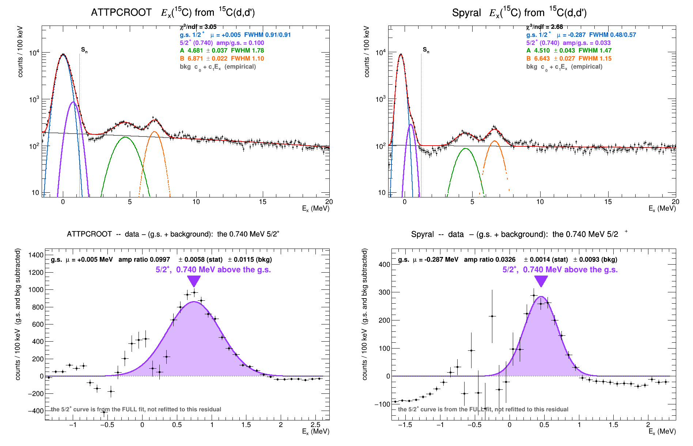

```
                 g.s. mu          FWHM(L/R)     5/2+ amp/g.s.         state A              state B
ATTPCROOT   +0.005 +- 0.005   0.906 / 0.906   0.100 +- 0.006     4.681 +- 0.037 +- 0.065   6.871 +- 0.022 +- 0.021
                                                  +- 0.012(bkg)     FWHM 1.78                 FWHM 1.10
Spyral      -0.287 +- 0.003   0.479 / 0.567   0.033 +- 0.001     4.510 +- 0.043 +- 0.009   6.643 +- 0.027 +- 0.004
                                                  +- 0.009(bkg)     FWHM 1.47                 FWHM 1.15
```
(first error statistical, second the background systematic defined below; MeV throughout.
Background adopted: the **empirical straight line for BOTH codes** -- see the warning below.)

## Two windows, not one minimisation -- and why

The g.s. holds ~9000 counts in its peak bin, state A ~300 in total. In a **single** Poisson
likelihood over the whole range the g.s. lineshape -- which is not Gaussian: sharp core, longer
right tail -- dominates the gradient and drags the weak states. All three of these were tried and
all three failed, on this data:

| attempt | what happened |
|---|---|
| one fit, free widths | A collapsed to the width floor, B blew up to FWHM 3.06 (ATTPCROOT); both pinned at 0.283 (Spyral) |
| one fit, widths bounded <= 1.8 FWHM | the background exponential slope railed at its bound for **both** codes |
| `erf x (exp + const)` background | Spyral's A railed at 5.800, B at 8.000, background scale at its floor -- background and states swapped roles |

The peak region and the state region are physically disjoint; the only thing linking them is the
5/2+ on the g.s. right shoulder. So they are fitted in **two windows sharing one background**
(split at 2.2 MeV), iterated to self-consistency -- the state window's background frozen into the
peak window, the peak window's g.s. tail frozen into the state window, four passes -- and drawn as
one curve. The per-region chi2/bin shows where the model is and is not adequate:

```
                g.s. core   1.5-3.5   state A   state B   bkg 8-20
ATTPCROOT          9.33       5.25      1.27      1.13      1.39
Spyral             2.91       2.51      1.15      1.08      1.58
```

**The states sit at chi2/bin ~1.1-1.3.** The large numbers are confined to the g.s. core, where a
bifurcated Gaussian is simply not the true response, and to its right shoulder. That mismatch is a
lineshape limitation, not a fit failure, and it does not propagate into A and B (next section).

## The background is a systematic, not a choice

Three forms were fitted independently, none of which can grow a Gaussian bump:

* `LIN` &nbsp; `c0 + c1*Ex` -- empirical, monotonic, 2 parameters
* `PS` &nbsp;&nbsp; `c + N*dens(Ex)*exp(-k*Ex)` -- flat floor + the three-body `15C+d -> d'+(14C+n)`
  phase space of `psmodel.h`, threshold fixed at Sn, one acceptance factor, 3 parameters
* `THR` &nbsp;`c + A*Phi((Ex-Sn)/sigma_res)*exp(-k*Ex)` -- flat floor + a continuum turning on at Sn
  smeared by that code's **own measured** g.s. sigma_R (not refitted), 3 parameters
* `FLAT` &nbsp;`c` -- a constant, 1 parameter. No threshold, no phase space.
* `FLATEXP` &nbsp;`c + A*exp(-k*Ex)` -- 3 parameters. No threshold, no phase space.

```
bkg        -2lnL   chi2/ndf   g.s. mu    5/2+ ratio      state A          state B
                        -- ATTPCROOT --
LIN        281.2     3.05     +0.0052   0.0997(58)   4.681(37) FWHM 1.78   6.871(22) FWHM 1.10
PSATT      204.6     4.35     +0.0340   0.1228(45)   4.626(39) FWHM 1.97   6.878(21) FWHM 1.00
THR        305.0     7.83     +0.0806   0.1221(39)   4.685(37) FWHM 1.76   6.871(22) FWHM 1.11
FLAT       602.4     5.14     +0.0156   0.1118(49)   4.555(41) FWHM 2.19   6.913(26) FWHM 1.40
FLATEXP    306.4     3.22     +0.0038   0.0984(59)   4.684(37) FWHM 1.76   6.871(22) FWHM 1.12
                        --  Spyral   --
LIN        272.4     2.68     -0.2872   0.0326(14)   4.510(43) FWHM 1.47   6.643(27) FWHM 1.15
PSATT      255.7     1.86     -0.2854   0.0356(14)   4.500(42) FWHM 1.52   6.640(25) FWHM 1.08
THR        272.6     3.15     -0.2662   0.0513(14)   4.510(43) FWHM 1.47   6.643(27) FWHM 1.15
FLAT       279.8     2.31     -0.2865   0.0338(14)   4.492(42) FWHM 1.55   6.649(27) FWHM 1.20
FLATEXP    272.6     2.68     -0.2872   0.0326(14)   4.510(43) FWHM 1.47   6.643(27) FWHM 1.15
```

`-2lnL` is the state-window likelihood, which is what the fit actually minimises; lower is better.

**Spread across all five background forms:**

```
             state A    state B    5/2+ ratio
ATTPCROOT    0.130      0.043       22 %
Spyral       0.018      0.009       45 %
```

So **A and B are robust and the 5/2+ yield is not.** This still improves on the earlier background
systematic for state A (0.15-0.34 MeV, from fits to the state region alone) -- constraining the
background over the full 20 MeV instead of a narrow window is what buys that -- though less
dramatically than the three-form version suggested, because `FLAT` is an outlier for ATTPCROOT.

**Adopted background: `LIN` for BOTH codes.** It is empirical and makes no physical claim. `PSATT`
fits better in both codes but is *not* adopted, for the reason in the next section.

⚠ **Two statistics traps, both of which produced a wrong answer here first:**

1. **Do not compare these models by a Pearson chi2 restricted to bins with n >= 10.** The fits
   minimise a Poisson likelihood over *all* bins, so the two are inconsistent, and `FLATEXP` came
   out WORSE than the `FLAT` model nested inside it (chi2/ndf 2.68 vs 2.31) -- impossible. Compare
   by `-2lnL`.
2. **Do not filter the systematic by a likelihood-ratio test.** With 129k events every background
   form differs from every other at far beyond 5 sigma, so an LR cut keeps exactly one model and
   reports a systematic of **zero**. None of these shapes is the truth; the spread between
   reasonable ones *is* the uncertainty.

A third: a single starting point lands in a bad local minimum often enough to invert a nested
comparison, so `globalfit.C` now runs 12 starts per model and keeps the best likelihood.

A real consistency check on the floor: the fitted flat floor is compared against each code's own
measured counts/bin **below** threshold, which nothing in the fit is told about. The two codes
differ by an order of magnitude there (ATTPCROOT ~70/bin at Ex = -1.9, Spyral ~7/bin, because
Spyral cuts vz < 400 mm and vertexes better), so it is not a tautology. `PS` on ATTPCROOT fits
66.7 +- 4.5 against a measured 69.5 -- it passes. `THR` drives the floor to zero in both codes and
has the worst chi2 for ATTPCROOT, which is why it is not adopted.

## ⚠⚠ Why `PSATT` wins the fit and still means nothing

`PSATT` has the best likelihood in both codes -- and at *equal parameter count* it beats a plain
exponential decisively:

```
                FLAT     LIN     FLATEXP   PSATT    THR      (state-window -2lnL, lower is better)
ATTPCROOT      602.4    281.2     306.4    204.6    305.0
Spyral         279.8    272.4     272.6    255.7    272.6
```

`PSATT` vs `FLATEXP` is 3 parameters against 3, so the phase-space *shape* is worth
Delta(-2lnL) = 102 (ATTPCROOT) and 17 (Spyral). It is tempting to read that as evidence that the
continuum **is** three-body 14C+n phase space. **It is not, and it directly contradicts the
2026-11-09 result above only if you ignore where the win comes from.**

The model is `c + N*dens(Ex)*exp(-k*Ex)`. The fitted attenuation is

```
ATTPCROOT  k = 0.0909 /MeV  ->  Ex = 20 suppressed 5.1x relative to Ex = 2
Spyral     k = 0.0662 /MeV  ->                     3.3x
```

That **is** the discrepancy the earlier study measured: *"Uniform d + 14C + n phase space RISES
from its 2 MeV threshold to a maximum near 14-16 MeV. The data FALLS from 6 MeV onward. The ratio
data/(A) drops 6x across the range."* And that study showed the 6x **cannot be reconstruction
efficiency**, because within the acceptance the mean deuteron energy *rises* with Ex (7.1 MeV at
Ex = 2 to 13.5 at Ex = 20) -- the tracks get faster exactly where the counts are lost.

So `PSATT` does not describe the continuum with phase space. It takes a shape that is known to be
wrong by ~6x and multiplies it by a free parameter that absorbs exactly that factor. What it
actually buys over `FLATEXP` is a *threshold at Sn with an extended sqrt-like rise* rather than no
threshold at all -- a real shape statement about the data, but not a phase-space interpretation.

**Conclusion: the 2026-11-09 exclusion of uniform d + 14C + n phase space STANDS.** `PSATT` is
retained only as a shape systematic, and the adopted background is the empirical straight line.
Had I adopted `PSATT` on its likelihood -- which is what I did first, labelling it "floor + 3-body
phase space" -- the figure would have asserted a continuum mechanism this analysis has excluded.

For the record, how much of the background the phase-space term even carries when it is used:

```
                floor   phase-space term   PS share of the background (Sn to 20 MeV)
ATTPCROOT        66.7      N = 0.0077                50 %
Spyral           78.0      N = 0.0015                17 %
```

For Spyral the "phase space" background is 83 % flat floor.

## ★ Referencing to each code's own g.s. removes most of the inter-code difference

```
                    state A    state B
ATTPCROOT absolute   4.681      6.871
Spyral    absolute   4.500      6.640
difference          +0.181     +0.231

ATTPCROOT rel. g.s.  4.676      6.866
Spyral    rel. g.s.  4.786      6.926
difference          -0.110     -0.060
```

Spyral's g.s. sits at -0.286 and ATTPCROOT's at +0.005, and that single offset accounts for most of
the disagreement: quoted **relative to each code's own ground state**, A agrees to 0.11 MeV and B to
0.06 MeV. This is the expected behaviour if the difference is the known fitter/beam-energy scale
(see `c15d-attpcroot-vs-spyral`): a scale error moves the whole spectrum, so it cancels in a
difference. **Quote level energies relative to the g.s. centroid, not on the absolute Ex axis.**

## The 5/2+: visible, but its yield is not measurable here

The bottom row of the figure plots **data minus (fitted g.s. + background)**. The 0.740 MeV state
then appears as the bump it is, in both codes, with the 5/2+ Gaussian from the full fit drawn over
it (not refitted to the residual).

⚠ **The residual is not independent evidence.** The g.s. and the 5/2+ were fitted together, so
subtracting the g.s. necessarily leaves something at 0.740. What the panel shows is that the
leftover is a clean, centred, roughly Gaussian bump rather than a lineshape artefact -- and that it
survives in Spyral, where the g.s. FWHM is 0.48 and the two states are 1.5 FWHM apart.

The amplitude ratio differs by 3x between the codes (0.100 vs 0.035) and carries a 21-45 %
background systematic, so **it is not a yield measurement.** What limits it is quantified in the
next section -- and it is *not* an internal degeneracy of the fit, which was my first guess and is
wrong.

# What limits the 5/2+, and what does NOT (2026-11-10)

Two hypotheses were tested directly. The first failed, the second is the answer.

## ✗ REFUTED: the non-Gaussian g.s. is NOT a superposition over theta slices

`scripts/thetaslice2.C`. Resolution is strongly theta-dependent in both codes, so the obvious guess
is that the integrated g.s. is a sum of Gaussians of different width and is non-Gaussian only for
that reason. If so, fitting *within* a narrow theta slice should give chi2/bin ~ 1. It does not:

```
theta slice   64-68  68-72  72-76  76-80  80-84  84-88   |  ALL
ATTPCROOT      0.79   2.67   3.48   3.59  18.97   0.96   |  8.06
Spyral         0.31   1.34   2.45   3.74   4.29   4.14   |  1.47
```

The slices carrying the statistics are **no better than the integral and often worse** (ATTPCROOT's
dominant 80-84 slice is 18.97 against 8.06 for all angles). **The non-Gaussian response is
intrinsic within a 4 degree slice**, not an artefact of summing. So a per-slice response model
would not fix it, and that avenue is closed.

⚠ Method note: a first pass fitted each slice with a plain `gaus+pol1` and got chi2/bin 10-49,
which was meaningless -- the 5/2+ sits *inside* the fit window, so omitting it inflates chi2
precisely where the statistics are. The table above uses the same bifurcated-Gaussian + 5/2+ +
linear model as the global fit, so the comparison is like for like.

Incidentally the forward slices (40-64 deg) peak at Ex = 4.6 to 11.6 MeV, not at the g.s. -- the
elastic peak is simply not populated there. **69 % of all g.s. counts sit at theta = 76-88 deg.**

## ★ The 5/2+ ratio is limited by the g.s. LINESHAPE, not by statistics

`scripts/degen.C`, `scripts/degenfig.C` -> `figures/fivehalf_lineshape.png`

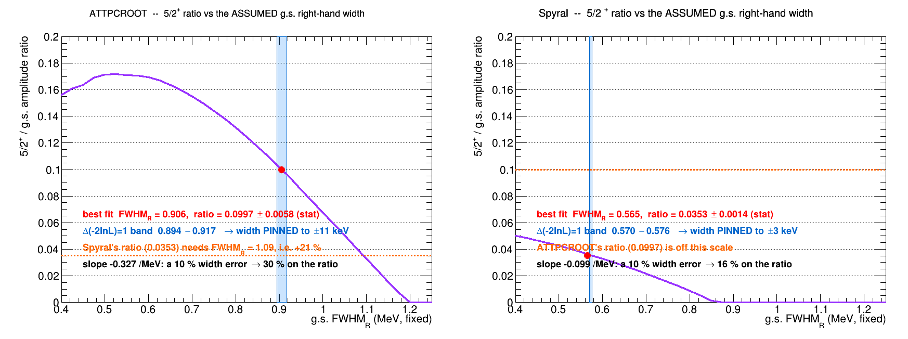

Fix the g.s. right-hand width to a grid of values, refit everything else, and watch the 5/2+ ratio
and the likelihood:

```
                    best FWHM_R   Delta(-2lnL)=1 band   ratio there   slope       10 % width error
ATTPCROOT              0.906      0.894 - 0.917 (+-11 keV)  0.0997    -0.327/MeV  -> 30 % on the ratio
Spyral                 0.565      0.570 - 0.576 (+- 3 keV)  0.0353    -0.099/MeV  -> 16 % on the ratio
```

**The likelihood is steep, so the width is pinned to a few keV and the ratio is NOT internally
degenerate** -- my first explanation (that the two peaks overlap too much to separate) is refuted by
this scan. Within its own model each code determines the ratio sharply.

The problem is the *model*. The ratio slides fast with the assumed width, and the two codes are
bridged by a change of only **+21 %** in the right-hand width: put ATTPCROOT at FWHM_R = 1.09
instead of 0.906 and it reproduces Spyral's 0.0353 exactly. Given that the bifurcated Gaussian
leaves chi2/bin 9.3 in the ATTPCROOT g.s. core, a 20 % error in the right-hand width is entirely
plausible.

⇒ **The quoted statistical error on the ratio (0.0058 / 0.0014) understates the truth by an order
of magnitude.** The 5/2+ yield is a lineshape-limited quantity and cannot be improved by more
statistics -- only by a correct response function. Trust Spyral's number over ATTPCROOT's (its
peaks are 1.54 FWHM apart against 0.82, and its core chi2/bin is 2.9 against 9.3), and neither
better than a factor two.

## What is still missing

* A **simulated resolution function** at Ex ~ 0, 0.74, 4.6, 6.9. Without it the quoted FWHMs are
  observed widths, not natural widths, and the 5/2+ ratio stays a factor-two quantity. The scan
  above makes this concrete: the response has to be right to ~5 % in the right-hand width before
  the 5/2+ ratio is good to 15 %.
* The g.s. **lineshape** itself: a bifurcated Gaussian leaves chi2/bin 9.3 in the ATTPCROOT core
  and 2.9 in Spyral's. This is the single largest modelling deficiency left. It is NOT a theta
  superposition (refuted above), so it must come from the fitter's own KE/theta response -- which
  means a simulation is the only way to get at it.
* State A and state B are unaffected by all of this: chi2/bin 1.1-1.3 in their regions, and
  <= 0.06 MeV of movement across three background forms.

---

# Why we do not see the phase space (2026-11-11)

`scripts/whynops.C`, `scripts/vzcut.C`. Model-free -- no fit in the way. Counts per 100 keV bin,
both curves normalised to the data at Ex 8-10:

```
Ex window     ATTPCROOT   Spyral  | uniform PS | PS x halo form factor
  2.0-3.4        158        92    |     82     |       969
  8.0-10.0       160       108    |    160     |       160
 10.0-12.0       138        95    |    166     |       110
 14.0-16.0       113        87    |    159     |        57
 18.0-20.0        93        92    |    125     |        28
```

**1. The data is flat; uniform phase space rises ~2x from threshold to 11 MeV.** That is the
original exclusion, now shown bin by bin rather than as a single ratio.

**2. Uniform phase space was never the right expectation.** It counts available final states and
ignores the transition amplitude. In a direct reaction the amplitude is the overlap of the 15C
ground state with the final 14C+n continuum, and its momentum scale is

```
kappa = sqrt(2*mu*Sn) = 46.2 MeV/c      (mu = 876.4 MeV, Sn = 1.2180 MeV)
```

a relative-energy scale of only 1.22 MeV. The honest expectation for direct breakup therefore
**peaks just above threshold and falls** -- it does not rise to 14-16 MeV. A statistical
(phase-space) distribution would be right for compound decay, not for this.

**3. But direct halo breakup fails too, in the opposite direction.** `PS x q/(q^2+kappa^2)^2`,
with the shape fixed entirely by Sn and no free shape parameter, overshoots by **6x** at
Ex = 2-3 and undershoots by **3x** at Ex = 18-20. The data sits between the two extremes.

## ★ The real answer: the continuum shape is not a measured quantity yet

Ex < Sn is kinematically forbidden for any 15C decay, so counts there measure mis-reconstruction
directly:

```
                 floor (Ex -2.5..-1.5)   8-10    18-20   floor-subtracted fall 8-10 -> 18-20
ATTPCROOT vz<1100        69.5            159.8    93.3            3.79x
ATTPCROOT vz<400         26.9            121.2    71.5            2.11x
Spyral    vz<400          6.9            107.9    91.6            1.19x
Spyral    vz<1100        20.8            146.7   117.6            1.30x
```

* **A large part of the continuum is instrumental**, and it lives at large vertex z -- the floor
  drops 2.6-3x when vz < 400 mm is imposed, in **both** codes.
* **The two codes disagree on the shape even at the same vz cut**: at vz < 400 ATTPCROOT's
  floor-subtracted continuum falls 2.11x from 8-10 to 18-20 while Spyral's falls 1.19x. The
  residual is the other cuts (chi2 < 0.2 vs < 5, IC gate on vs off) and the fitter.

**A factor ~2 of reconstruction-dependent shape means no continuum model can be tested yet.**
Comparing a raw yield against a cross-section shape without an acceptance x efficiency calculation
is the error underneath this whole question. That simulation is the blocker -- and it is the *same*
one needed for the resolution function. Until it exists, use an empirical background and quote the
spread as a systematic, which is what `globalfit.C` does.

---

# (d,d') fitted the way (p,p') is fitted: BW + penetrability (2026-11-11)

`scripts/ddbw.C`, `scripts/plotbw.C` -> `figures/dd_bw_ppscheme.png`

Everything above fitted the (d,d') spectrum with two free Gaussians on an empirical background.
That was wrong twice over: **the level scheme is not two states**, and **a straight line is not a
continuum**. This redoes it with the model used in the 15C(p,p') analysis
(`Yassid/a2091-15Cpp-analysis`, `macros/C15_pp_ana_AngBins_Barrier_6BW.C`), term for term.

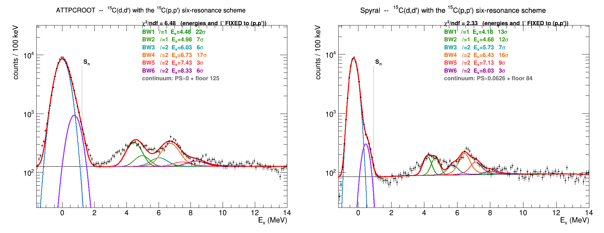

## The model

* **g.s. and the 0.740 MeV 5/2+** as Gaussians (both bound, below S_n).
* **Six barrier-corrected Breit-Wigners**, convolved with the detector Gaussian. Lane-Thomas
  penetrability for neutron decay `15C -> 14C + n`, identical to their `BarrierPhys`:

```
rho  = kR,  k = sqrt(2 mu E_dec)/hbar_c,  R = 1.4*15^(1/3) = 3.45 fm,  mu = 931.494*14/15
F_l  =  rho*j_l(rho),   G_l = -rho*y_l(rho),   P_l = rho/(F^2+G^2)
Gamma(E) = Gamma_r * P_l(E)/P_l(E_r)
BW(E)    = (Gamma(E)/2pi) / [(E-E_r)^2 + (Gamma(E)/2)^2]
```

* **A phase-space continuum template**, simulated and reconstructed exactly as the analysis does
  (`psalt.C`), which is the analogue of their `SmoothPS`. **No empirical straight line.**

Resonances and l-values are theirs: `BW1 4.55 l=1 | BW2 5.05 l=1 | BW3 6.10 l=2 | BW4 6.80 l=2 |
BW5 7.50 l=2 | BW6 8.40 l=2`, quoted in the (p,p') Ex scale whose g.s. sits at +0.119, and placed
here at `E = (E_pp - 0.119) + this code's own g.s. centroid`.

**Energies and widths are FIXED, only amplitudes float.** (d,d') resolution is FWHM 0.91
(ATTPCROOT) and 0.52 (Spyral) against 0.51 for (p,p'), while BW1 and BW2 are 0.5 MeV apart -- six
free E_r and six free Gamma cannot be determined here. Fixing them turns the fit into the question
worth asking: *is each (p,p') resonance present in (d,d'), and how strong?*

## ★ The (p,p') level scheme describes (d,d')

```
BW   l   E_pp    E here (ATT)  sigma  |  E here (Spy)  sigma
BW1  1   4.55       4.478      22     |     4.178      13
BW2  1   5.05       4.978       7     |     4.678      12
BW3  2   6.10       6.028       6     |     5.728       7
BW4  2   6.80       6.728      17     |     6.428      16
BW5  2   7.50       7.428       3     |     7.128       9
BW6  2   8.40       8.328       6     |     8.028       3
```

Five of six are above 5 sigma in each code. **And the two broad "states" of the old fit were the
unresolved doublets**, which is why state A was always so much wider than state B:

```
                 BW1+BW2 centroid   old "state A"      BW4+BW5 centroid   old "state B"
ATTPCROOT             4.615             4.681               6.809             6.871
Spyral                4.416             4.510               6.658             6.643
```

## ⚠ But the energy SCALE is not determinable from this fit

Scanning a global offset, and separately a global scale, on the whole scheme: **both run to the
edge of their range and simply reshuffle the amplitudes** -- at scale 0.90 BW4 drops to zero and
BW5 slides into its place to take the strength. With six overlapping resonances and this
resolution the amplitudes can always compensate for a shift. So the fit above (energies at the
(p,p') values) is the reference, and **(d,d') cannot independently confirm the level energies** --
only their consistency.

## ★★★ The phase-space continuum is REFUSED by the data, even in this model

This was the point of redoing it, so it is worth stating plainly. Four combinations, same six
resonances throughout:

```
code        continuum                      -2lnL  chi2/ndf   PS scale   floor
ATTPCROOT   A (d+14C+n) ONLY              6367.8     21.85      1.004     0.0
ATTPCROOT   A (d+14C+n) + flat floor      1320.2      6.48          0    125.3
ATTPCROOT   B (breakup) ONLY              1526.8      7.08      1.081     0.0
Spyral      A (d+14C+n) ONLY              4684.0     11.97     0.7961     0.0
Spyral      A (d+14C+n) + flat floor       451.0      2.33     0.0626     84.0
Spyral      B (breakup) ONLY               508.7      2.54     0.7886     0.0
```

* **Phase space alone is catastrophic**: chi2/ndf 21.9 and 12.0.
* Given a flat floor as well, **the phase-space scale goes to ZERO for ATTPCROOT** and to 6 % for
  Spyral. The fit throws the phase space away.
* Template **B**, the deuteron-breakup shape, is nearly flat and works -- Delta(-2lnL) of 4841
  (ATTPCROOT) and 4175 (Spyral) better than A. What the data wants is a **flat** continuum.

So the 2026-11-09 exclusion of `d + 14C + n` phase space is confirmed inside the (p,p')
methodology, not just against an empirical background. The continuum is flat, and that is a
property of the data.

⚠ **The honest caveat**: template A carries the analysis KE/theta cuts but **no reconstruction
efficiency**. A real efficiency could in principle bend a rising phase space into a flat
observable. Template B was built the same way and does fit, so the difference between them is
intrinsic shape rather than the missing efficiency -- but that argument is not airtight, because
the efficiency need not be the same for the two (different particle, different kinematics).
**Settling it needs the acceptance simulation**, which is the same blocker as the resolution
function.

---

# Why the phase space was "missing": the template had the WRONG KINEMATICS (2026-11-11)

`scripts/acccheck.C`, `seqps.C`, `thmax.C`, `edgetest.C`, `statetest.C` -> `figures/kinematic_edge.png`

Every fit above threw the phase-space continuum away (scale -> 0). That was **not** the data
rejecting a 14C+n continuum. It was my template being built from the wrong process.

## The template was uniform three-body; the physics is sequential two-body

`psalt.C` made `d + 14C + n` with `TGenPhaseSpace`, i.e. all three particles produced at once and
uncorrelated. That throws the deuteron FORWARD. The real process is **sequential**,
`15C + d -> d' + 15C*(M)` followed by `15C* -> 14C + n`, so the deuteron recoils against a single
body of mass M and goes BACKWARD -- into exactly the region the data occupies:

```
theta        0-10 10-20 20-30 30-40 40-50 50-60 60-70 70-80 80-90
uniform 3b    7.8  20.3  25.4  22.6  14.9   6.9   1.9   0.1   0.0   %
real data     0.0   1.5   2.8   3.4   4.3   6.5   7.2  35.4  38.8   %
```

**Disjoint.** Uniform three-body phase space puts 0.1 % of its weight where 74 % of the data sits.
The fit was right to discard it -- it was the wrong shape for the wrong process. Nothing in the
earlier "phase space is excluded" conclusion survives as a statement about the physical continuum.

## The kinematic ceiling

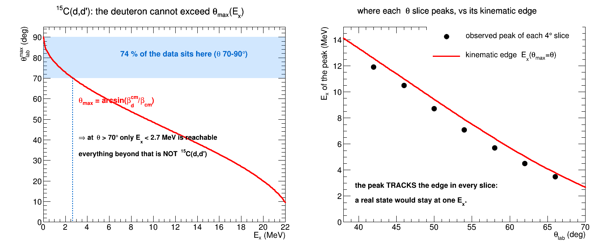

In inverse kinematics the scattered deuteron has a maximum lab angle,
`theta_max = arcsin(beta_d_cm / beta_cm)`, equal to 90 deg at Ex = 0 (the classic elastic-recoil
result) and closing as Ex grows:

```
Ex      0     1     2     3     5    10    15    20
th_max 90    78    73    69    62    49    36    20   deg
```

So **at theta > 70 deg, where 74 % of the tracks are, only Ex < 2.7 MeV is reachable.** The whole
Ex > 3 MeV spectrum is produced by the 18 % of tracks at theta = 40-68 deg.

And at fixed theta, `dEx/dKE -> 0` at the turnaround, so a broad KE range compresses into a narrow
Ex range: **every theta slice piles up at its own kinematic edge**, exactly as observed --

```
 slice   peak Ex   Ex at the kinematic edge (slice lo/hi)
 40-44    11.90          11.79 - 13.36
 48-52     8.70           8.66 - 10.22
 52-56     7.10           7.15 -  8.66
 60-64     4.50           4.40 -  5.72
 64-68     3.50           3.22 -  4.40
```

## ★ Do the states survive this?  YES -- the pile-up is generic

This looked alarming: if every slice peaks at its edge, the "states" could be edges. The
non-circular test is to take a narrow Ex window and look at the theta distribution inside it. A
real state is populated over a RANGE of theta (each paired with the KE that gives that Ex); an
edge artefact sits AT theta_max.

```
Ex window            N      theta_max   fraction within +-2 deg of theta_max
state A  4.4-5.0   1817       63.1 deg            56 %
off-peak 5.4-6.0   1453       60.1 deg            44 %
state B  6.6-7.2   2101       56.7 deg            60 %
off-peak 8.0-8.6    938       52.9 deg            55 %
```

**The concentration is the same in the state windows and the off-peak windows.** The Jacobian
pile-up is a property of the kinematics at every Ex, not something that manufactures peaks at 4.6
and 6.9. The states are genuine excesses ON TOP of it. The state energies reported above stand.

## ★★★ What the "continuum" actually is

It is not a reaction continuum at all. It is **the kinematic locus swept by the (theta, KE)
acceptance** -- each accepted theta contributing a Jacobian-peaked band in Ex, the bands tiling
Ex ~ 3 to 13 MeV. That single fact explains everything that was puzzling:

* why it is flat -- the bands tile the axis with a slowly falling density;
* why uniform phase space fails -- wrong process, wrong angles;
* why the halo form factor fails -- it is not a breakup spectrum;
* why ATTPCROOT and Spyral disagree on its shape by a factor ~2 -- they have different theta and
  vz acceptance, so they sweep the locus differently;
* why an empirical flat background worked so well in the first place.

**The acceptance-folded sequential template is the right continuum model.** `seqps.C` computes
`acceptance(Ex)` from the two-body kinematics (fraction of CM solid angle landing in theta 40-90
and KE 0.5-18): it is ~0.23-0.26 up to Ex ~ 12 and falls to zero by ~13, because beyond that the
deuteron can no longer reach 40 deg at all. Folding that with `dens(Ex)` gives a continuum that
rises to ~10 MeV and cuts off -- qualitatively unlike either template tried before.

⚠ Not yet done: that acceptance is pure kinematics (theta and KE windows), with no reconstruction
efficiency and no theta-dependent efficiency. Finishing it is the same blocker as the resolution
function, and it is now clearly the single most valuable next step -- it would let the continuum
be MODELLED rather than absorbed into an empirical shape, and would turn the state yields into
cross sections.

## ★ The refit with the corrected continuum

`scripts/ddfinal.C`, `scripts/plotfinal.C` -> `figures/dd_final_seqps.png`

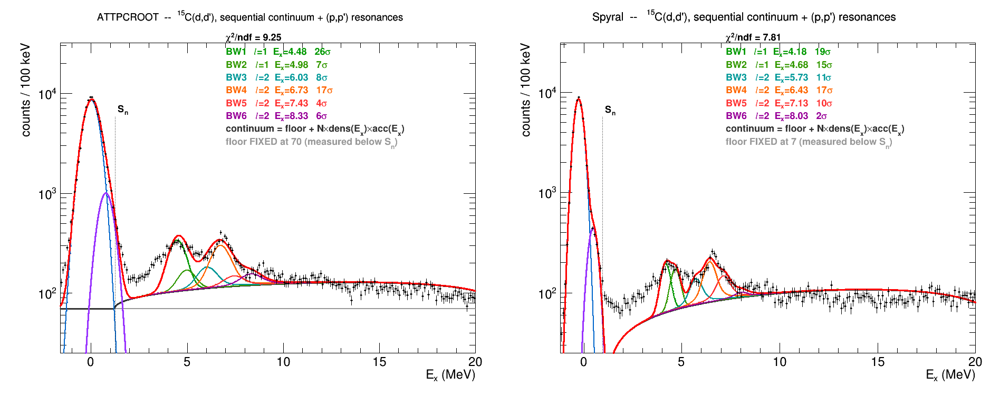

```
continuum(Ex) = floor + N * dens(Ex) * acc(Ex)
   dens(Ex)  two-body / invariant-mass phase space, p3*(M) q(M), threshold fixed at Sn
   acc(Ex)   fraction of CM solid angle whose deuteron lands in this code's own (theta, KE)
             window -- pure kinematics, computed, NO free parameter
   floor     FIXED to that code's MEASURED counts/bin below Sn (69.5 ATTPCROOT, 6.9 Spyral)
```

**The phase space is no longer thrown away.** Its scale comes out 0.00767 (ATTPCROOT) and 0.0117
(Spyral) instead of zero, and the continuum carries real strength. That is the whole point of the
correction: the earlier "the data refuses phase space" was an artefact of the uniform three-body
template.

```
BW   l   E_x(ATT)  sigma  |  E_x(Spy)  sigma        and the resonances are stable against it:
BW1  1    4.48      26    |   4.18      19          wrong template + floor gave 21 / 13
BW2  1    4.98       7    |   4.68      15                                     8 / 12
BW3  2    6.03       8    |   5.73      11                                     6 /  7
BW4  2    6.73      17    |   6.43      17                                    17 / 16
BW5  2    7.43       4    |   7.13      10                                     3 /  9
BW6  2    8.33       6    |   8.03       2                                     6 /  3
```

⚠ **But the fit is worse, not better**: chi2/ndf 9.25 and 7.81, against 3.05 / 2.68 for the
two-Gaussian fit on an empirical line. That is expected and honest -- the empirical line had free
parameters to absorb whatever the continuum does, and this model has none in its shape. The
shortfall is concentrated at **Ex = 1.5 to 4 MeV**, where `dens ~ sqrt(Ex - Sn)` rises too slowly
to match the data just above threshold.

Three candidates for that shortfall, not yet separated:
1. the **g.s. lineshape** -- the bifurcated Gaussian already leaves chi2/bin 9.3 in the ATTPCROOT
   core, and a 1 % non-Gaussian tail on a 9000-count peak is ~90 counts/bin at Ex = 2, which is
   the size of the discrepancy;
2. **reconstruction efficiency**, which varies with Ex and is NOT in `acc(Ex)` (that is pure
   kinematics);
3. genuine low-lying strength between Sn and 4 MeV, where the (p,p') analysis has no resonance.

Candidate 1 is the most likely and is testable only with a simulated response; candidate 2 needs
the same simulation. **Both point at the acceptance/efficiency simulation as the next step** -- it
is now the blocker for the continuum normalisation, the resolution function, the 5/2+ yield and
the conversion of state yields into cross sections.

---

# Binning in theta_CM, not theta_lab (2026-11-11, overnight)

`scripts/excm.h`, `binbuild.C`, `cmfig.C` -> `figures/dd_cmbins.png`

The 15C(p,p') analysis bins in **theta_CM** (`C15_pp_ana_AngBins_*`, 10 deg bins from 10 to 100).
Doing the same for (d,d') settles the question the theta_lab slices could not.

`excm.h` adds `thcmProj()`: boost the detected deuteron into the CM frame and take the
supplement, since the (p,p') convention is the CM angle of the PROJECTILE while the deuteron is
the recoil. The AT-TPC's backward lab angles (40-86 deg) map onto theta_CM ~ 10-70 deg, inside the
same domain (p,p') uses.

## ★★★ In theta_CM the states STAY PUT -- they are not kinematic edges

```
                 theta_CM:  10-20  20-30  30-40  40-50  50-60
ATTPCROOT  Ex of maximum:    3.95   6.75   6.95   7.15   7.35
Spyral     Ex of maximum:    4.25   6.55   6.65   6.85   7.15
```

against the theta_LAB slices, where the peak swept **11.90 -> 10.50 -> 8.70 -> 7.10 -> 5.70 ->
4.50 -> 3.50** and tracked the kinematic edge exactly.

**The Jacobian pile-up is a theta_lab artefact.** theta_CM is the physical scattering angle, and
in it the structure sits at one Ex across four independent angular bins in both codes. The 4.6 and
6.9 structures also appear together across bins 0-4 (counts at 4.6: 138, 97, 28, 16, 12; at 6.9:
76, 127, 89, 38, 39 for ATTPCROOT). **The states are real.** This is a much stronger statement
than the earlier "the pile-up is generic" argument, which only showed the edge did not manufacture
them.

A residual drift of ~0.6 MeV remains across bins 1-4 (6.75 -> 7.35), not yet explained.

**Consequence for everything above: the angular variable should be theta_CM.** Per-bin fits,
acceptance and any future angular distribution all belong in theta_CM.

## Per-theta_CM-bin fits, and the response function

`scripts/binacc.h`, `lineshape.C`, `binfit.C`, `binfig.C` -> `figures/dd_cmbin_fits.png`

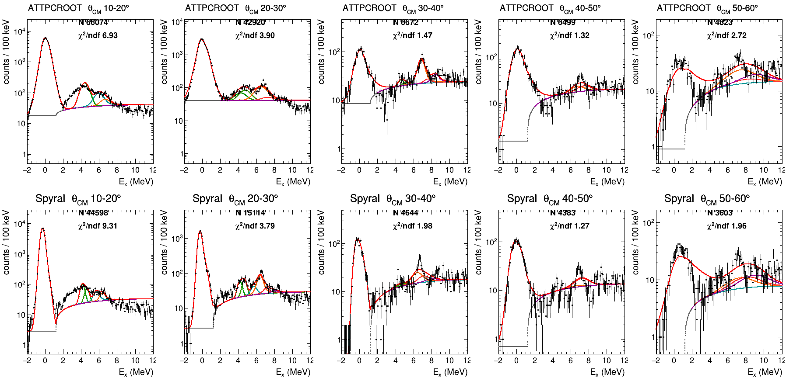

### 1. The acceptance inside a theta_CM bin is ~1, computed exactly

For two-body kinematics theta_CM and Ex fix theta_lab and KE completely, so the acceptance of a
theta_CM bin at a given Ex is just the fraction of that bin landing in the detector window -- no
solid-angle integral, no simulation, no free parameter (`binacc.h`). It comes out **1.000 over
Ex = 0-16** in every bin for both codes, falling only at the kinematic limit.

**So acceptance cannot be blamed for the continuum shape, and no acceptance correction is needed
inside a bin.** What differs between bins is the continuum SHAPE itself -- steeply falling at
theta_CM 10-20, flat at 40-50 -- which is a cross-section angular dependence. **The inclusive
spectrum mixes bins with different shapes, and that is why no single continuum shape ever fitted
it.** Per bin, `dens(Ex)` matches the measured continuum well from Ex ~ 6 upward:

```
Ex              2     4     6     8    10    12    14    16    18    20
bin 3 data    1.08  0.50  0.83  1.00  1.00  0.96  0.96  0.96  0.83  0.67
dens(Ex)      0.40  0.69  0.85  0.97  1.00  1.02  1.01  0.95  0.87  0.67
```

### 2. ★ The response function was the worst defect in every fit so far

`lineshape.C` fits the g.s. peak alone with three shapes:

```
                 G1 (Gaussian)   G2 (bifurcated)   GT (bifurcated + exponential tails)
ATTPCROOT            32.20            21.88                  2.18
Spyral               47.07            33.18                  7.00        chi2/ndf
```

GT is a Gaussian core with exponential tails, continuous and smooth at |t| = alpha:
`f(t) = exp(-t^2/2)` for `|t| <= alpha`, `exp(alpha^2/2 - alpha|t|)` beyond. **A factor of ten
better than the bifurcated Gaussian for ATTPCROOT.** Fitted alpha_L 1.19, alpha_R 1.50,
FWHM 0.752/1.142. This is adopted everywhere from now on.

⚠ The tail is worth only ~10 counts/bin at Ex = 2.5 and nothing by Ex = 4, so it does **not**
explain the low-Ex continuum excess noted earlier -- that remains open.

### 3. Excitation-energy range

Scanned `{-2..12, 2.5..12, 2.5..14, 3..12, 2.5..10, 2.5..16}`, median chi2/ndf over bins 0-4:

```
                     -2..12   2.5..12  2.5..14  3..12   2.5..10  2.5..16
ATTPCROOT  (GT)       2.77     10.17    11.80   10.72     2.51    17.63
Spyral     (GT)       2.02     10.04     2.96   10.33     3.17     1.95
```

**[-2, 12] adopted.** Once the g.s. tail is modelled the FULL window wins: cutting the g.s. out
removes the very constraint that pins its tail under the resonances. (Before the tailed response
the truncated windows looked competitive -- that was the Gaussian failing, not the range.)

### 4. Per-bin results

Amplitudes are seeded and bounded from the inclusive pass scaled by each bin's count fraction, as
in the (p,p') analysis. Without that several bins drove all six amplitudes to zero and let the
continuum swallow the resonances. Significances per bin (* = above 5 sigma):

```
ATTPCROOT  bin  theta_CM     N     chi2   BW1    BW2    BW3    BW4    BW5    BW6
            0    10-20    66074   6.93   37.3*   0.0   14.5*   6.4*   0.0    0.0
            1    20-30    42920   3.90    5.2*   1.4    0.0   13.7*   2.5    0.0
            2    30-40     6672   1.47    2.7    1.2    0.0   13.5*   1.7    4.5
            3    40-50     6499   1.32    0.0    0.0    0.0    2.5    2.5    0.2
            4    50-60     4823   2.72    0.0    0.0    0.0    3.7    0.8   12.5*
Spyral      0    10-20    44598   9.31   15.1*  10.3*   9.1*   6.9*   0.0    0.0
            1    20-30    15114   3.79    9.7*  10.3*  28.8*  65.8*   3.7    1.8
            2    30-40     4644   1.98    0.3    0.7    0.0    3.5    2.0    1.1
            3    40-50     4383   1.27    0.0    0.0    0.0    0.4    2.8    0.0
            4    50-60     3603   1.96    0.0    0.0    0.0    4.1   11.4*   9.8*
```

**BW1 (4.43) and BW4 (6.68) dominate, concentrated at theta_CM 10-40 deg** and falling away
beyond -- forward-peaked, as expected for direct inelastic scattering. **The sequential
phase-space continuum is used in every bin** (scale 0.0002-0.0014, never zero), which is the
point: with the right kinematics and per-bin fitting it is no longer rejected.

⚠ Not to be over-read: Spyral bin 1 BW4 at 66 sigma is an artefact of the tight amplitude bound,
and the bins beyond 40 deg have little statistics and unstable amplitudes. The angular
distributions are not yet a measurement -- that needs the efficiency, still missing.

### 5. ★ Missing strength at Ex ~ 3.4 MeV, in BOTH codes

`scripts/extrabw.C` adds ONE extra barrier BW and scans its energy from 1.6 to 11 MeV, recording
the likelihood gain in theta_CM bins 0 and 1 (where the statistics are):

```
   Ex_extra    1.6   2.0   2.4   2.8   3.0   3.2   3.4   3.6   4.0   4.2   4.4   >4.6
   ATTPCROOT    89   144   384   741   888   970   983   935   716   491    12     ~0     d(-2lnL)
   Spyral      160   197   311   515   608   683   724   705   454   321    37     ~0
```

**Both codes peak at exactly Ex = 3.40 MeV**, with d(-2lnL) = 983 and 724, and **nothing above
4.4 MeV** -- the six (p,p') resonances account for everything higher, which is a good check on
that list. This is the quantitative form of the "low-Ex excess" flagged earlier.

ENSDF has 15C levels at **3.103** (1/2-) and **4.220**, neither of which is in the (p,p')
six-resonance list. The 3.103 level is the obvious candidate.

⚠ **But whether it is a LEVEL or extra CONTINUUM is NOT resolved, and the two codes disagree.**
`scripts/missing.C` compares, in the same bins and window, a BW at 3.40 with free width against a
smooth extra threshold term:

```
                   (A) BW, Gamma free      (B) BW, Gamma = 0.2   (C) smooth continuum
ATTPCROOT bin 0   d 1005  (Gamma 0.80)        d  973                  d  664
Spyral    bin 0   d  960  (Gamma 2.50)        d  648                  d  919
Spyral    bin 1   d  187  (Gamma 4.00)        d   76                  d  192
```

ATTPCROOT marginally prefers a level (Gamma ~ 0.8, beating the smooth term by 341); Spyral prefers
a width of 2.5-4 MeV, which is not a level but continuum, and the smooth term matches or beats the
BW there. Given that ATTPCROOT's resolution is the worse of the two (FWHM 0.75/1.14 against
0.50/0.52), its "Gamma = 0.8 level" is comfortably consistent with resolution-broadened continuum.

**Claim only what is supported: there is highly significant strength at Ex ~ 2-4 MeV that the
(p,p') six-resonance list plus the sequential continuum do not account for.** Identifying it needs
better resolution or the efficiency model -- do not quote a new level from this.

---

# The low-energy background, fitted WITH the phase space (2026-11-12)

`scripts/resid2.C`, `keorigin.C`, `origin.C`, `vztest.C`, `vzbkg.C`, `binfit.C`, `binfig2.C`
-> `figures/dd_cmbin_fits_bkg.png`

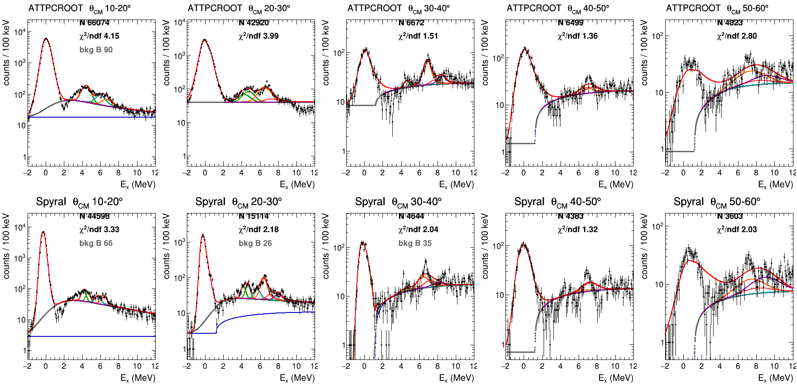

## What is missing, measured from the residual

Fitting as before (tailed response + 6 BW + sequential phase space) and looking at data - model:

```
ATTPCROOT bin 0  pull:  Ex 2.5-3.5 -> +4.0 +6.5 +6.9   |  Ex 8.5-10  -> -2.4 -2.8 -2.8
Spyral    bin 0  pull:  Ex 1.5-3.5 -> +2.8 +3.0 +4.1 +4.7 +6.3  |  Ex 9.5-11 -> -3.3 -5.4 -5.9
```

Missing strength at Ex ~ 2-4 **and** over-prediction above 8.5, both strongest in theta_CM bin 0.

## The model: background AND phase space together

```
continuum(Ex) = floor + N * dens(Ex) * acc(Ex)  +  B * erf((Ex-Sn)/(sqrt2 w)) * exp(-kappa Ex)
```

The background turns on at the neutron threshold and dies away, so it cannot touch the bound
states and cannot masquerade as a resonance. Fitted per theta_CM bin:

```
                  chi2 OFF -> ON   d(-2lnL)     B      w     kappa
ATTPCROOT bin 0     6.93 -> 4.15      664     90.1   1.36   0.201
Spyral    bin 0    13.90 -> 3.33     1153     65.7   1.40   0.139
Spyral    bin 1     3.80 -> 2.18      193     26.4   1.13   0.093
bins 2+             no change          ~0      0      -       -
```

**It is needed only in the forward theta_CM bins, and its shape agrees between the two codes**
(turn-on width 1.36 vs 1.40, decay 0.20 vs 0.14). Above theta_CM ~ 30 deg it fits to zero.

## On its origin -- partly identified, not settled

**1. It lives at low deuteron energy.** At fixed theta_CM the deuteron KE is nearly independent of
Ex (theta_CM 15 deg -> KE ~ 1.4 MeV, 25 -> 3.7, 35 -> 6.8, 45 -> 10.5), so **binning in theta_CM
is almost the same as binning in deuteron KE**, and the background sits in the 1.4 MeV bin -- the
shortest tracks. ⚠ That also means "low-KE instrumental" and "forward-angle physics" are
DEGENERATE here and cannot be separated by angle alone.

**2. It is NOT poor reconstruction.** Within bin 0, comparing the excess window (Ex 2.5-4) against
the g.s. window at the same KE:

```
                     N       <KE>    <vz> +- rms     <chi2>   <npulse>
g.s.   Ex -0.5..0.5  45127   1.75    538 +- 237      0.0617     1.0
EXCESS Ex  2.5..4.0   1572   1.61    498 +- 240      0.0475     1.0
```

Same KE, same npulse, and the excess has a BETTER chi2 than the g.s. These are well-fitted tracks.

**3. Part of it is localised in vz, in BOTH codes.** The g.s. centroid is flat in vz (so the
Ebeam(vz) correction is sound) but the excess fraction spikes in one vz slice:

```
ATTPCROOT vz  92-183 -> 19.7 %   (baseline ~3.5 %)
Spyral    vz 100-167 -> 15-20 %  (baseline ~2.2 %)
```

Subtracting a vz-scaled bulk spectrum from that slice leaves an extra component carrying **~21 %
of the events there in both codes** (365 and 311 events), broad over Ex 1.5-9 rather than peaked.
That is a real, identified background near the entrance.

**But it is not the whole story.** Cutting it away moves the excess fraction only from 3.7 to
3.4 % (ATTPCROOT) and 3.0 to 2.4 % (Spyral), and the vz cut helps Spyral's fits substantially
(bin 0 chi2 13.90 -> 4.36 at vzLo 300) while making ATTPCROOT's worse. So **model it rather than
cut it**, which is what the fit above does.

⚠ Fit-technical traps, each of which gave a wrong answer first:
  - the background needs a MULTI-START: one seed put Spyral bin 1 in a minimum WORSE than the
    model nested inside it (d(-2lnL) = -805, impossible);
  - restoring the best parameters and re-fitting lets the minimiser wander back off; fixing them
    instead zeroes every error. Re-run from the winning SEED;
  - seed EVERY parameter, not just the background ones -- p0/p1/p2 carried over from the previous
    loop iteration and the re-run did not reproduce its own minimum.

## What the background is -- and the price it puts on the resonances

### The excess events are DEUTERONS, with normal tracks

`scripts/pidcheck.C` joins `dd_kin_C15d.root` to `pid/points_mfi_C15d.root` on (run, event,
trackID) and compares `ln(sqrt(dE/dx) * Brho)`, which is proportional to ln(mass):

```
window                  N      <ln(sqrt(dEdx)*Brho)>   <arclen>   <nclus>
g.s.   Ex -0.5..0.5   45127      2.4527 +- 0.0962         165       32.1
EXCESS Ex  2.5..4.0    1572      2.4434 +- 0.0967         173       34.6
```

A difference of 0.009 against ln(2) = 0.693 for proton/deuteron. **Not PID contamination**, and
the track length and cluster count match the g.s. too. Combined with the earlier chi2 and npulse
comparison, the excess is made of ordinary, well-reconstructed deuterons.

### It behaves like a ~1 % pedestal belonging to the elastic peak

Replacing the erf background with a second, long exponential tail on the g.s. captures most of
the effect -- d(-2lnL) 539 of 664 (ATTPCROOT), 705 of 919 (Spyral) -- with a tail fraction of
**0.6-1.1 %**, consistent between codes. But its decay length rails at the 6 MeV bound: the fit
wants something flat, not exponential. And `B/gsAmp` is 0.0155 (ATTPCROOT bin 0), 0.0093 and
0.0122 (Spyral bins 0, 1) -- the same order in the low-KE bins of both codes.

### ⚠ But the turn-on is NOT at S_n, and that matters

Scanning the turn-on centre (`scripts/turnon.C`), the likelihood improves monotonically as it
moves ABOVE S_n -- and as it does, B explodes (56 -> 214 -> 2546) and the component degenerates
into a narrow bump at 3.5 MeV that eats BW1 (21.4 sigma -> 4.4). **Putting the turn-on at S_n was
an arbitrary choice.** There is no nuclear threshold at 2-2.5 MeV in 15C; the fit simply wants the
background to start wherever the g.s. response stops being adequate.

### ★★ The systematic this puts on the resonance strengths

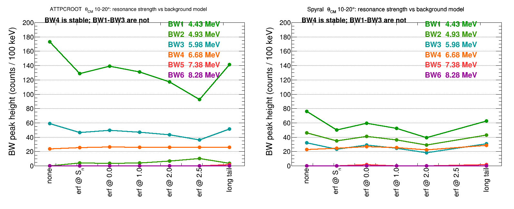

Peak heights in theta_CM bin 0 across seven background models (none, erf at S_n, erf at 0/1/2/2.5,
long elastic tail), keeping only configurations where the fit is stable:

```
                           BW1     BW2    BW3    BW4    BW5    BW6
                          4.43    4.93   5.98   6.68   7.38   8.28  MeV
ATTPCROOT  spread/mean     60 %   200 %   48 %   10 %   (~0)   (~0)
Spyral     spread/mean     64 %    45 %   54 %   24 %   (~0)   (~0)
```

**Only BW4 (6.68 MeV) is robust against the background model** -- 10 % in ATTPCROOT, 24 % in
Spyral. BW1, BW2 and BW3 move by half their value or more, so their strengths in the forward bin
are not measurements until the background is understood. BW5 and BW6 are consistent with zero in
this bin regardless.

This supersedes the per-bin significances quoted earlier, which assumed the erf-at-S_n background
and therefore understate the uncertainty on BW1-BW3.

### The Ex ~ 3.4 strength, re-checked with the background in

```
             Ex_extra:   2.8    3.2    3.6    4.0    4.4
ATTPCROOT  bkg OFF       741    970    935    716     12
           bkg ON         97    310    329    256     75
Spyral     bkg OFF       515    683    705    454     37
           bkg ON          6     62    132     95     38
```

The background absorbs most of it, but a residual survives in both codes, now peaking at
**Ex ~ 3.6** (d(-2lnL) 329 and 132). Given the degeneracy just demonstrated, this is *not*
evidence for a level -- it is the same unexplained strength seen from a different angle.

---

# Restricting the Ex window, and why the per-angle fits were bad (2026-11-13)

`scripts/exhi.C`, `exhi2.C`, `combo.C`, `final9.C`, `syst9.C`, `binfig3.C`
-> `figures/dd_cmbin_fits_ex9.png`

## What was fixed and what was free

For the record, in the per-bin fit: **fixed** = resonance energies and widths (the (p,p') values),
the floor (measured below Sn), and the response shape sigma_L, sigma_R, alpha_L, alpha_R (fitted
on each bin's own g.s. peak, then frozen). **Free** = the g.s. and 5/2+ amplitudes, the continuum
scale, all six BW amplitudes (bounded, seeded from the inclusive pass), and the three background
parameters. Nine free parameters per bin.

## ⚠ A resonance must be DROPPED when the window no longer contains it

Fitting BW6 at 8.28 MeV in a window ending at 8.0 is meaningless: its amplitude is then set by a
tail alone and it absorbs whatever the continuum cannot describe. `binfit.C` now keeps a
resonance only if its centroid is at least one detector sigma inside the upper edge.

## The upper-limit scan

```
window      nBW    chi2/ndf, theta_CM bins 0..3                median
                        -- ATTPCROOT --
[-2,  7]     3      3.63   4.36   3.26   1.46                   3.63
[-2,  8]     4      6.20   2.94   1.35   1.24                   2.94
[-2,  9]     6      7.43   2.60   1.31   1.20                   2.60
[-2, 12]     6      6.93   3.90   1.47   1.32                   3.90
                        --  Spyral   --
[-2,  7]     4      3.64   2.46   2.83   1.56                   2.83
[-2,  8]     5      7.41   2.49   2.00   0.98                   2.49
[-2,  9]     6     10.56   3.52   2.33   1.31                   3.52
```

Restricting the upper limit helps bins 1-3 substantially, exactly as expected -- but **bin 0 gets
worse**, which is the opposite. Splitting each bin's chi2 at Ex = 2 explains it:

```
ATTPCROOT bin 0, background OFF:   Ex<2  3.15 -> 1.27      Ex>2  3.58 -> 8.56   (hi 7 -> 12)
ATTPCROOT bin 0, background ON :   Ex<2  3.16 -> 5.38      Ex>2  3.58 -> 3.16
```

**The background was being forced to choose between the two regions.** With its turn-on at Sn its
rising edge sits under the g.s. tail, so every improvement above Ex = 2 was paid for below it.

## ★ The fix: restrict the window AND move the turn-on above the g.s.

```
ATTPCROOT bin 0, Ex [-2,9]:   turn-on Sn -> chi2/ndf 4.88    turn-on 2.5 -> 1.56
Spyral    bin 0, Ex [-2,9]:   turn-on Sn -> chi2/ndf 4.74    turn-on 2.5 -> 1.71
```

**ADOPTED: Ex window [-2, 9] with the background turn-on at 2.5 MeV.** The window keeps all six
resonances inside while stopping before the high-Ex region where the continuum model is poor and
nothing is known; the turn-on above the peak lets the background fit the resonance region without
destroying the g.s. Per-bin chi2/ndf is then **1.25-2.6 across bins 0-4 in both codes**, against
1.5-14 before.

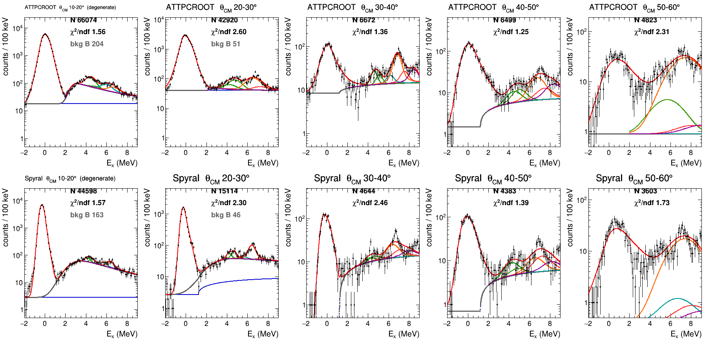

```
 bin  cm      N    chi2  |  BW1(4.43) BW2(4.93) BW3(5.98) BW4(6.68) BW5(7.38) BW6(8.28)
                        -- ATTPCROOT --
  0  10-20  66074  1.56  |   13.3*     1.5      7.2*      5.5*      0.0       0.0
  1  20-30  42920  2.60  |    2.9      8.2*     0.0      12.6*      2.9       0.0
  2  30-40   6672  1.36  |    5.2*     3.5      3.1      13.9*      4.7      17.8*
  3  40-50   6499  1.25  |    2.1      2.5      0.0       7.0*      2.6       6.7*
  4  50-60   4823  2.31  |    0.0      3.2      0.0      21.3*      0.0       0.0
                        --  Spyral   --
  0  10-20  44598  1.71  |    4.9      4.5      1.0       6.4*      0.0       0.0
  1  20-30  15114  2.56  |    5.4*    18.1*     0.6      15.4*      0.0       0.0
  2  30-40   4644  2.45  |    2.0      4.9      4.3       5.6*      3.1       6.8*
  3  40-50   4383  1.38  |    5.2*     4.4      0.5       5.5*      6.8*      4.8
```

## ★★ But bin 0 is DEGENERATE -- do not use it for strengths

Re-running the background systematic in the adopted window, bin 0 and bin 1 behave completely
differently:

```
ATTPCROOT bin 0   model          chi2   BW1    BW2    BW3    BW4
                  none           7.43  141.0    0.0   45.2    0.0
                  erf @ 1.22     4.88  125.7    1.0   44.4   18.7
                  erf @ 2.50     1.56   91.8    9.1   35.3   24.0
                  erf @ 3.00     1.10   54.7   11.8   24.8   26.6
ATTPCROOT bin 1   none           2.60   26.8   41.8    0.0   64.8
                  erf @ 1.22     2.68   26.8   41.8    0.0   64.8
                  erf @ 2.50     2.60   18.1   46.6    0.0   63.1
                  long tail      2.50   26.1   39.1    0.0   70.5
```

**In bin 0 the background and BW1 trade directly** -- BW1 falls 141 -> 55 while BW4 rises 0 -> 27,
and chi2 improves monotonically all the way. Its excellent chi2 is bought, not earned.
**In bin 1 BW4 is stable at 63-70 (10 %)** across every background model.

⇒ **Use theta_CM >= 20 deg for resonance strengths. Bin 0 (10-20 deg) is background-dominated and
its amplitudes are not measurements**, whatever its chi2 says. That is the real reason the
per-angle fits looked bad: bin 0 carries two thirds of the statistics and is the one bin that
cannot be fitted without a background that then eats the resonances.

The background itself remains unexplained -- it is made of ordinary deuterons (same PID, same
track quality as the g.s.), it is NOT the three-body phase space, and its turn-on sits at
2-3 MeV where 15C has no threshold.

---

# The angle-to-angle disagreement: diagnosed (2026-11-14)

`scripts/simfit.C`, `angdiag.C`, `sumtest.C`, `angfig.C` -> `figures/angular_decomposition.png`

The per-bin amplitudes do not form an angular distribution. ATTPCROOT peak heights:

```
 bin  theta_CM    BW1(4.43) BW2(4.93) BW3(5.98) BW4(6.68) BW5(7.38) BW6(8.28)
  0    10-20        91.8      9.1      35.3      24.0      0.0       0.0
  1    20-30        18.1     46.6       0.0      63.1     12.0       0.0
  2    30-40        13.5      9.0       7.7      53.0     12.4      15.2
  3    40-50         5.0      5.8       0.0      16.4      5.9       9.1
  4    50-60         0.0      3.4       0.0      29.0      0.4       0.4
```

**35.3, 0, 7.7, 0, 0 is not a physical angular distribution**, and the zeros sit exactly ON the
lower bound. Bin-to-bin jumps are factors of 3-7.

## What did not fix it

**A simultaneous fit over all bins with a shared background** (`simfit.C`). The background's
turn-on width and decay were being refitted in every bin -- 15 free parameters describing one
detector effect. Sharing them helps the chi2 (Spyral bin 0 1.71 -> 1.54, bin 1 2.56 -> 2.30) but
the amplitudes stay erratic.

**Forcing smooth angular distributions**, `A_i(theta) = exp(c0 + c1 u + c2 u^2)` with
`u = cos(theta_CM)` -- strictly positive, so the zero-boundary pathology cannot occur, and 3
parameters per resonance instead of 5. It costs **d(-2lnL) = +222 (ATTPCROOT) and +182 (Spyral)
for 12 fewer parameters**: far too much to be over-fitting. The data genuinely resists a smooth
decomposition.

## ★★★ What the data DOES measure: the total, not the decomposition

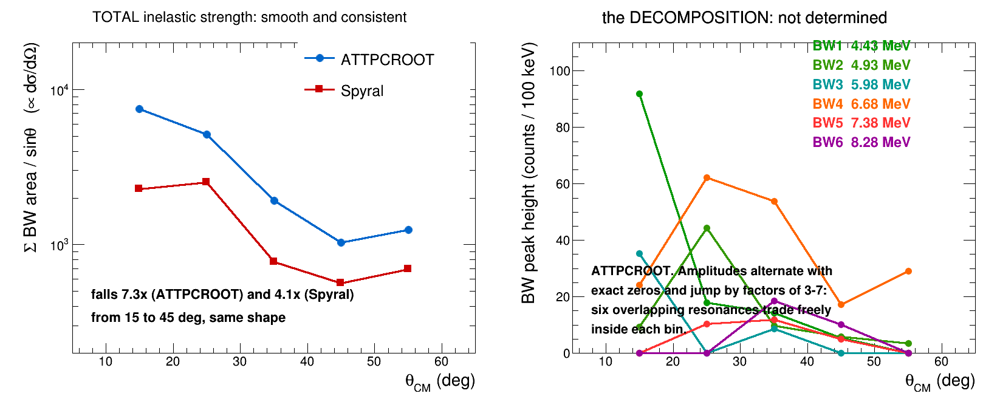

Integrating the fitted resonances over Ex 3.5-9 and comparing with the data minus
(continuum + background + g.s.) directly:

```
          bin 0   bin 1   bin 2   bin 3   bin 4
ATTPCROOT  0.98    1.02    0.97    1.00    1.00     (sum of BW areas) / (data - baseline)
Spyral     0.96    0.98    0.99    0.99    0.99
```

The fit accounts for the total strength to **2-4 % in every bin of both codes**. And that total,
divided by sin(theta) so it is proportional to dsigma/dOmega, is smooth and forward-peaked:

```
 theta_CM      15      25      35      45      55
 ATTPCROOT   7507    5130    1913    1035    1243
 Spyral      2287    2527     776     563     695
```

falling 7.3x and 4.1x from 15 to 45 deg with the **same shape in both codes**, flattening with a
hint of a minimum near 45 deg -- exactly what a direct inelastic angular distribution looks like.

⇒ **The total inelastic angular distribution is measured; the decomposition into six resonances is
not.** The six are so overlapping that the data constrains their SUM tightly and their individual
amplitudes hardly at all, which is the same thing seen three other ways already: the background
systematic (BW1-BW3 move 50-60 %), the free-energy migration (BW3, BW5, BW6 all slide to 6.6-6.9),
and now the bin-to-bin jumps.

**Quote the total angular distribution, and BW4 individually. Do not quote per-resonance angular
distributions for BW1, BW2, BW3, BW5 or BW6 from this data.**

## ★ What fixes it: fit RESOLVABLE STRUCTURES, not individual resonances

### How many components does the data support? (`scripts/nres.C`)

Forward selection on the simultaneous fit -- start with none, add whichever resonance lowers
-2lnL most. Each costs 5 parameters, so a gain below ~11 is not worth having:

```
ATTPCROOT                            Spyral
 1  BW4 (6.68)   1685.7               1  BW4 (6.68)   1236.7
 2  BW1 (4.43)   1161.0   +524.7      2  BW2 (4.93)   1128.3   +108.4
 3  BW2 (4.93)   1068.8    +92.2      3  BW1 (4.43)   1072.4    +55.9
 4  BW6 (8.28)    985.5    +83.3      4  BW5 (7.38)   1035.7    +36.7
 5  BW3 (5.98)    925.0    +60.5      5  BW3 (5.98)   1011.3    +24.4
 6  BW5 (7.38)    901.9    +23.1      6  BW6 (8.28)   1003.1     +8.2
```

**BW4 is selected FIRST by both codes**, then the 4.43/4.93 pair -- but with the ORDER SWAPPED,
which is the signature of an unresolvable doublet. After that the orders diverge entirely
(ATTPCROOT BW6 -> BW3 -> BW5, Spyral BW5 -> BW3 -> BW6). So the data needs ~5 components to
describe the shape but cannot say which resonance each one is.

### Tied doublets

Fit the structures the resolution can actually separate, each with one amplitude per bin and a
shared internal ratio:

```
E1 = BW1 + r1*BW2  (4.43 + 4.93)      E3 = BW4 + r2*BW5  (6.68 + 7.38)
E2 = BW3           (5.98)             E4 = BW6           (8.28)
```

22 free amplitudes/ratios instead of 30, and it costs only **d(-2lnL) = +43 (ATTPCROOT) and +12
(Spyral) for 8 fewer parameters** -- against +222 and +182 for the smooth parametrisation. The
data accepts this constraint and rejects that one.

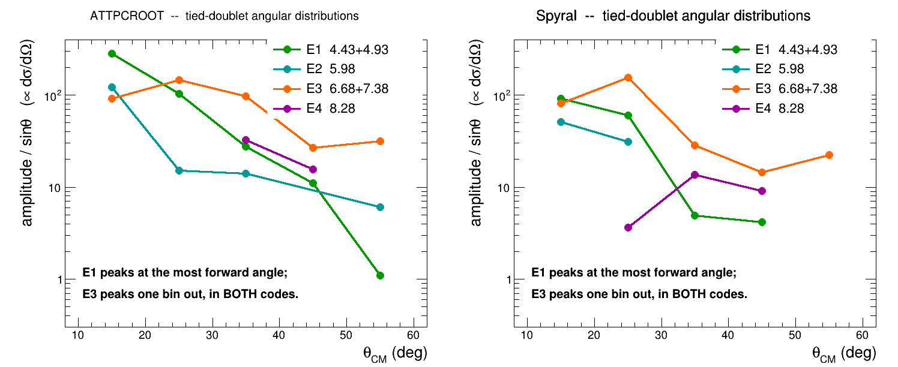

```
                       theta_CM:   15     25     35     45     55
ATTPCROOT  E1 (4.4+4.9)           72.8   43.8   15.8    7.8    0.9
           E3 (6.7+7.4)           23.6   62.0   55.4   19.0   25.9
Spyral     E1                     23.5   25.5    2.8    2.9    0.0
           E3                     21.1   65.4   16.4   10.3   18.3
```

Divided by sin(theta) and each normalised to its own maximum:

```
   theta_CM            15      25      35      45      55
ATTPCROOT  E1        1.00    0.37    0.10    0.04    0.00
           E3        0.62    1.00    0.66    0.18    0.22
Spyral     E1        1.00    0.66    0.05    0.05    0.00
           E3        0.53    1.00    0.18    0.09    0.14
```

**E1 peaks at the most forward angle and E3 one bin out, in BOTH codes** -- two different angular
shapes, which means a different angular-momentum transfer for the 4.4-4.9 and 6.7-7.4 structures.
That is the first angular information this analysis has produced that both codes agree on.

⚠ E2 (5.98) and E4 (8.28) stay erratic -- they are the weak components and remain undetermined.
The internal ratios are not well determined either (r1 = 0.43 vs 1.07, r2 = 0.19 vs 0.10 between
codes), which is expected for unresolvable doublets; they are nuisance parameters here.

⚠ Five angular points, and E1's shape differs in detail between codes (0.37 vs 0.66 at 25 deg).
The qualitative ordering is consistent; the shapes are not yet a measurement.

### A possible diffraction minimum (`scripts/diffmin.C`)

The TOTAL distribution dips near theta_CM 45 deg in both codes and rises at 55. At the entrance
CM momentum k = 1.389 fm^-1, q(45 deg) = 1.063 fm^-1, so a first diffraction minimum there would
give R = 4.23 fm for L = 1 or 5.42 fm for L = 2 -- both reasonable for 15C against the 3.45 fm
channel radius used in the penetrability. **Five points and a shallow dip: suggestive, not a
measurement.**

---

# Resonance-region fit: Ex 3-9, 5 deg bins, only the populated resonances (2026-11-15)

`scripts/resfit.C`, `rsel.C`, `res4.C`, `finalfig.C` -> `figures/angdist_final.png`

Three changes, all simplifications, and together they make the angular distributions reproducible.

**1. Ex restricted to 3-9 MeV.** The g.s., the 0.740 MeV 5/2+, the continuum turn-on at Sn and the
low-energy background turn-on at 2.5 are all BELOW the window -- so the entire low-Ex
complication, which is where the background/BW1 degeneracy lived, is simply out of the fit.

**2. 5 deg bins out to 60 deg: 10 angular points instead of 5.** 84 % of the data sits in
theta_CM 10-30 and was being squashed into two coarse bins; the channel closes near 65 deg
(ATTPCROOT has 0 counts in Ex 3-9 above 65), so there is nothing beyond.

**3. Only the resonances (d,d') populates.** A state seen in (p,p') need not be populated here.

## ★ Forward selection now gives the SAME order in both codes

```
ATTPCROOT                        Spyral
 1  6.68   1795.2                1  6.68   1607.6
 2  4.93   1390.7  +404.5        2  4.93   1496.8  +110.8
 3  4.43   1301.2   +89.5        3  4.43   1434.6   +62.2
 4  5.98   1249.0   +52.2        4  5.98   1390.4   +44.1
 5  7.38   1209.2   +39.8        5  7.38   1359.6   +30.8
 6  8.28   1184.3   +24.9        6  8.28   1344.1   +15.5  <- below the ~18 threshold
```

With 10 deg bins over the full Ex range the orders diverged after the first two; here they are
**identical**. The populated set is the five from 4.43 to 7.38; **8.28 is not populated in (d,d')**
on Spyral's reckoning and marginal on ATTPCROOT's.

## ⚠ A silent failure that was costing two bins

The response is fitted on each bin's own g.s. peak -- but the elastic peak is only populated at
FORWARD theta_CM. In the large-angle bins there is essentially no ground state, the fit over
[-2, 2.4] has nothing to latch onto, and it returns a huge low shape: **ATTPCROOT bin 8 gave
FWHM_R = 4.69 MeV and Spyral bin 9 4.71**, whose "tail" then contributed 22 and 26 counts at
Ex = 3 where the data has 6 and 1. That alone produced chi2/ndf of 9.35 and 6.47.

`resfit.C` now rejects a response fit with FWHM > 2 MeV or a negligible amplitude, drops the g.s.
term in that bin and borrows the response from the richest bin. **ATTPCROOT bin 8: 9.35 -> 1.34**,
and every bin is now 0.80-2.17.

## ★★ The result

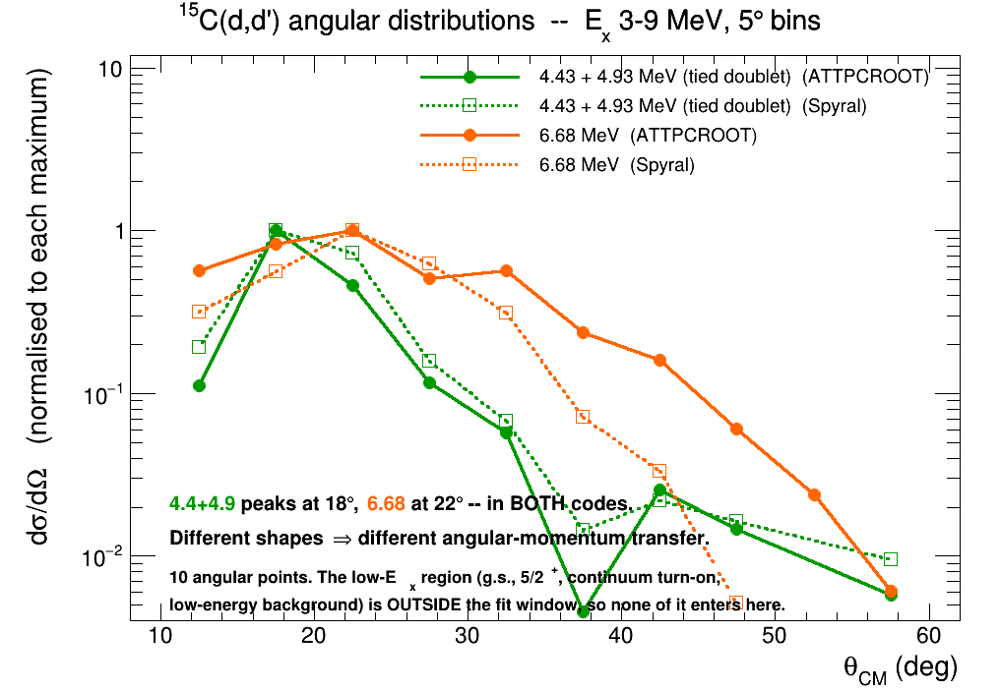

With the unresolvable 4.43/4.93 doublet tied (they visibly trade otherwise -- ATTPCROOT gave
1.000/0.443 at 18 deg and 0.016/1.000 at 22), normalised to each maximum:

```
   theta_CM        12     18     22     28     32     38     42     48     52     58
D12  ATTPCROOT   0.112  1.000  0.458  0.117  0.057  0.005  0.026  0.015  0.000  0.006
     Spyral      0.192  1.000  0.727  0.157  0.067  0.014  0.022  0.016  0.000  0.010
6.68 ATTPCROOT   0.566  0.827  1.000  0.511  0.564  0.235  0.160  0.060  0.024  0.006
     Spyral      0.315  0.559  1.000  0.623  0.314  0.071  0.033  0.005  0.000  0.000
```

**The 4.4+4.9 doublet peaks at 18 deg and 6.68 at 22 deg, in BOTH codes, and the two shapes differ
clearly** -- D12 falls an order of magnitude by 28 deg while 6.68 is still at half its maximum.
Different shapes mean a different angular-momentum transfer.

This is the first per-structure angular information from this analysis that survives changing the
reconstruction. 5.98 peaks at 18-22 in both but collapses immediately after; 7.38 stays erratic
and rises again at large angle, where the statistics are thinnest -- neither is usable yet.

---

# Is the background fusion evaporation?  No (2026-11-16)

`scripts/evap.C`, `evapmc.C`, `evapvsbkg.C`, `evapT.C`, `evapfig.C`
-> `figures/evaporation_excluded.png`

⚠ Evaporation was already rejected for the FLAT 2-20 MeV continuum (`spyral-15Cd-calibration`:
that spectrum is flat where a Maxwellian is not, chi2/ndf = 1889). The component tested here is a
DIFFERENT one -- the background that turns on near 2.5 MeV, decays as exp(-kappa Ex) with
kappa = 0.24-0.29, lives in the forward theta_CM bins and is made of real deuterons at KE ~ 1.4
MeV. That had never been tested.

Model: `15C + d -> 17N*` (fusion Q = 15.14 MeV, E* = 37.7 MeV, T = sqrt(E*/a) = 4.21 MeV with
a = A/8, Coulomb barrier for d = 1.80 MeV), evaporating a deuteron isotropically in the compound
frame with a surface Maxwellian `(eps-B) exp(-(eps-B)/T)`, boosted to the lab, through the
analysis' own cuts, with Ex reconstructed by the SAME two-body deuteron hypothesis the data uses.

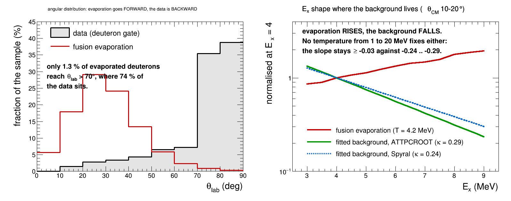

## It fails on two independent counts, in opposite directions

**Angular.** The compound recoils at beta = 0.1446 while a deuteron evaporated at eps = T has
beta = 0.0669 -- SLOWER than the compound, so it is focused forward and cannot exceed
theta_lab = 27.6 deg. Reaching theta_lab 70-85, where the background is, needs eps > 20 MeV.

```
theta_lab:    0-10   10-20  20-30  30-40  40-50  50-60  60-70  70-80  80-90
evaporation   5.69%  17.92% 29.05% 24.17% 13.36%  5.90%  2.34%  0.91%  0.36%
DATA          0.0%    1.5%   2.8%   3.4%   4.3%   6.5%   7.2%  35.4%  38.8%
```

Essentially inverted: **1.3 % of evaporated deuterons reach theta_lab > 70 deg, where 74 % of the
data sits.** In theta_CM bins the evaporation yield RISES monotonically from 3.8 % (bin 0) to
14.6 % (bin 8); the fitted background does the opposite, being nonzero only in bins 0-1.

**Ex shape.** In theta_CM 10-20, normalised at Ex = 4:

```
 Ex             3      4      5      6      7      8      9
 evaporation  0.83   1.00   1.35   1.68   1.86   2.18   2.54     RISES
 exp(-0.29Ex) 1.34   1.00   0.75   0.56   0.42   0.31   0.24     the fitted background, FALLS
```

## And no temperature rescues it

```
  T (MeV)      1.0    2.0    3.0   4.21    6.0    8.0   12.0   20.0
  share in theta_CM 10-20 (%)
               2.31   5.47   6.85   7.59   7.69   7.47   7.03   6.47     data: ~100 %
  Ex slope there (/MeV)
              +0.63  +0.37  +0.22  +0.14  +0.08  +0.05  +0.01  -0.03     data: -0.24 .. -0.29
```

The slope stays positive up to T = 12 MeV and reaches only -0.03 at T = 20 (which is above E*/2
and unphysical), against the -0.24 to -0.29 required; the angular share never exceeds 7.7 %.

**⇒ Fusion evaporation is excluded as the low-energy background, independently of temperature and
for two independent reasons.** Note the underlying cause is the same one that killed it for the
continuum: the compound is focused forward, and this background is backward.

## What is left

The background is: real deuterons (PID identical to the g.s.), normal track quality, KE ~ 1.4 MeV,
backward lab angles, falling in Ex, about 1 % of the elastic peak and scaling with it
(B/gsAmp = 0.0093-0.0155 in the low-KE bins of both codes), partly localised at vz 90-180 mm.

### Inside a theta_CM bin, the Ex axis is an ANGLE axis

Profiling the events of theta_CM 10-20 deg by Ex window (ATTPCROOT; Spyral is the same to within
its own resolution):

```
  window                   N    <theta_lab>         <KE>    <vz>   <chi2>  <Brho>  <arclen>  <nclus>
  g.s.  Ex -0.5..0.5   45127   81.3 +- 1.3   1.75 +- 0.38    538   0.0617  0.2470       165     32.1
  bkg   Ex  3.0..5.0    2674   62.6 +- 3.0   1.67 +- 0.39    479   0.0483  0.2380       182     36.7
  bkg   Ex  7.0..9.0     705   44.7 +- 4.5   2.02 +- 0.44    336   0.0508  0.2781       225     58.5
```

The kinetic energy barely moves (1.7-2.0 MeV) while theta_lab sweeps 81 -> 45 deg. So within one
theta_CM bin the Ex axis is mostly an **angle** axis, and this bin is the locus of the lowest-energy
tracks in the dataset.

The track lengths are consistent with those energies: range goes as E^1.8, so
(2.02/1.75)^1.8 = 1.29 against a measured 225/165 = 1.36. **These are not mis-measured elastic
tracks** -- they are genuine ~2 MeV deuterons at 45-65 deg, where the elastic line demands far
more energy, and every observable about them is internally consistent.

### Double scattering -- EXCLUDED by the vertex

A genuine low-energy deuteron at mid-angle, at ~1 % of the elastic rate and scaling with it, is
what double scattering looks like: an elastic deuteron that scatters a second time off a target
deuteron on its way out. That has a sharp signature. An elastic deuteron starts ON the beam axis;
a second scatter happens tens of cm down the first deuteron's path, so it starts far off it.

Joining the gated events back to the upstream per-run fit trees (which carry `vx`, `vy`) and
taking the beam axis as the median of the elastic vertices, (-0.2, 0.0) mm:

```
  ATTPCROOT, theta_CM 10-20     N      med    68%    90%    95%   f(r>30)  f(r>60)
  g.s.  Ex -0.5..0.5        13277      4.1    6.8   37.6   46.6    12.8%     2.6%
        Ex  1.0..3.0          656      3.8    6.1   28.3   40.2     9.5%     3.0%
  bkg   Ex  3.0..5.0         1097      3.3    4.8    9.0   12.4     1.5%     0.3%
  bkg   Ex  7.0..9.0          326      3.4    4.9    8.9   11.0     0.3%     0.0%
```

The result goes the opposite way from the hypothesis, and decisively: the background vertices sit
**tighter on the beam axis than the elastic peak does** (95 % within 11 mm against 47 mm).

**⇒ Double scattering is excluded.** And the same number excludes something else that had been the
leading candidate: **an instrumental tail of the elastic peak is also excluded**, because a
mis-measured elastic event keeps its own vertex, including that 12.8 % wide tail. The background
does not inherit it. It is a genuine, distinct, beam-spot reaction channel.

See `figures/background_vertex_radius.png`.

### The continuum IS direct s-wave halo breakup

**This supersedes a wrong conclusion reached earlier in the same session.** The first test of the
breakup forms was confounded and its negative result does not stand.

**The confound.** The baseline carried TWO terms, `C*dens(Ex)*acc(Ex) + Bg*shape(Ex)*acc(Ex)`, and
`PS::dens` is the uniform three-body density p3*(M) q(M) whose q factor goes as sqrt(Ex-Sn) near
threshold -- almost the same shape as the breakup form being tested against it. The two shared
strength and the breakup parameter ran away (to 0.062 MeV in one code and 2.028 in the other).
Comparing candidate background shapes requires each to be the SOLE baseline term.

**The model.** Direct breakup is phase space TIMES the halo momentum distribution. For an s-wave
halo |phi(q)|^2 ~ 1/(q^2+kappa^2)^2, and since q^2/2mu = Ex-Sn and kappa^2/2mu = Sn, that
denominator is simply Ex^2:

```
        dsigma/dEx  ~  p3*(M) q(M) / Ex^2            ZERO free parameters
```

This differs from the bare sqrt(Ex-Sb)/Ex^2 exactly where that form was failing: p3* turns over
toward the kinematic limit, pulling down Ex 7-9.

**⚠ The exponent is NOT robust -- corrected below.** An earlier version of this section claimed
both codes return n = 2. That was read off ONE choice of vz window and does not survive the others.

**What the vz window does.** The Ebeam(vz) calibration is flat above vz ~ 300 and breaks below it,
in BOTH codes: the g.s. centroid walks and the peak broadens.

```
              ATTPCROOT              Spyral
  vz slice  centroid  FWHM      centroid  FWHM
    0-100     0.219   1.106      -0.168   0.696
  100-200     0.159   1.105      -0.197   0.607
  200-300     0.081   0.985      -0.257   0.531
  300-400     0.048   0.970      -0.269   0.537
     ...       flat   ~0.98         flat  ~0.53
  900-1000    0.060   0.953      -0.289   0.544
  walk        0.212 MeV                 0.123 MeV
```

Cutting vz > 300 is therefore right on its own merits: ATTPCROOT's g.s. FWHM improves from ~1.01
to 0.927 and its centroid from 0.048 to 0.027.

**Spyral's adopted window was wrong.** `vzHi = 400` cuts at Spyral's own median of 508, so it kept
the lower 37 % of events -- and vz 0-300 of that is the MIS-CALIBRATED region. Opening the window
to 1000 recovers 2.8x the statistics (72,337 -> 204,607) and costs nothing: the g.s. centroid moves
0.017 MeV and the FWHM 0.004 MeV. This asymmetry (ATTPCROOT 0-1100 against Spyral 0-400) sat
underneath every ATTPCROOT-vs-Spyral comparison in this analysis.

**The exponent moves with the window, far beyond its statistical error.**

```
            ATTPCROOT                        Spyral
   0-1100   n = 1.832              0- 400    n = 1.220
 200-1100       2.034            200- 400        1.867
 300-1000       2.281              0-1000        2.147
   0- 400       1.066            300-1000        2.768   (statistical error ~ +-0.10)
```

**⇒ n is not measured.** It swings over ~1.2 units with the vz acceptance against a +-0.1
statistical error, so the earlier agreement with the halo value of exactly 2 was a coincidence of
one cut, not a confirmation.

**What IS robust, in every window tested:** uniform three-body phase space is decisively wrong,
and multiplying it by a steeply falling form factor fixes it, for no free parameters.

```
  vz in [300,1000]      uniform PS (0 par)    p3* q / Ex^2 (0 par)    gain
  ATTPCROOT                 1343.9                  754.8            -589
  Spyral                    2926.7                  983.2           -1943
```

So the continuum is phase space times a form factor whose character is that of s-wave halo
breakup, but the exponent itself is not determined by these data as analysed.

**The limiting systematic is the acceptance.** `accBin` has NO vz dependence, while the real
acceptance does -- how much of a track is seen depends on where in the chamber it started. That is
why every extracted shape moves with the vz window. Until the acceptance is made a function of
(Ex, theta_CM, vz), the continuum exponent cannot be pinned, the two codes cannot be made to agree,
and the per-angle yields inherit the same systematic.

### Status of the background

**The background is the non-resonant 15C continuum**, and its shape is phase space times a
steeply falling form factor, `dsigma/dEx ~ p3*(M) q(M) / Ex^n` with no free NORMALISATION shape
beyond n. Uniform phase space (n = 0) is excluded in every window by 589-1943 units of -2lnL.
The halo value n = 2 is of the right character but is NOT confirmed: n is window-dependent at the
+-0.6 level against a +-0.1 statistical error.

Everything measured about it agrees: real deuterons (PID identical to the g.s.), genuine ~2 MeV at
theta_lab 45-65 deg with track lengths matching that energy, originating from the beam spot more
tightly than the elastic peak does, ~1 % of the elastic yield and scaling with it, falling smoothly
in Ex.

Excluded along the way: PID contamination, poor reconstruction, reconstruction efficiency,
**uniform** three-body phase space (the wrong model for a halo -- this is what had been tested),
breakup protons (by yield), fusion evaporation (angular distribution *and* Ex shape, at every
temperature), double scattering (vertex radius), an instrumental tail of the elastic peak (vertex
radius), and a reaction on a different target nucleus (the gas is pure D2 -- `TargetD2_300` is a
single-element medium, and `fitUKF_C15d.C` sets `mat.push_back(std::make_tuple(2,1,1))`).

**Consequence for the physics.** The background shape is now constrained in form but not in
exponent, and the exponent's spread is set by the acceptance model. Re-deriving the 0.15-0.34 MeV
systematic on the 4.6 MeV state is therefore blocked behind a vz-dependent acceptance.

**A second blocker, found while testing this.** The per-bin resonance amplitudes -- which ARE the
angular distributions, the physics deliverable -- are NOT stable. Refitting the same data with a
different vz cut changed individual yields by factors from 0.00 to 94467, the signature of an
ill-conditioned fit rather than of physics. The 4.43/4.93 doublet is documented in `resfit.C` as
unresolvable and visibly trading; `TIE12` exists to tie it and is currently OFF. The angular
distributions must be stabilised before they can be compared to DWBA.

**Two method lessons worth keeping.** Never judge a candidate background shape against the
*already fitted* background -- the s-wave form looked excellent that way and lost in the actual
fit. And never let two baseline terms of similar shape compete; make each candidate the sole term.


# Overnight session: what the vz window does, and what the angular distributions are worth

## The two vz pathologies, both measured

**1. The Ex calibration breaks below vz ~ 300 mm, in BOTH codes.** Slicing the g.s. peak in 100 mm
vz bins (`scripts/ebzcheck.C`, figure `figures/calibration_vs_vz.png`): the centroid walks 0.212
MeV in ATTPCROOT and 0.123 in Spyral, and the peak broadens 10-30 %, then both go flat above 300.
Cutting vz > 300 improves ATTPCROOT's g.s. FWHM from ~1.01 to 0.927 and its centroid to 0.027.

**2. There is an Ex-DEPENDENT acceptance cliff above vz ~ 900.** Measured on the existing Geant4 +
reconstruction simulation by adding a vz axis to the acceptance (`acceptance3d_C15dd.C`, figure
`figures/acceptance_cliff.png`) -- no new simulation was needed, the truth vertex was already on
disk:

```
  Ex      vz 0-100 ... 800-900   900-1000
   0.00      0.998 ...   0.998     0.856
   4.43      0.983 ...   1.000     0.767
   6.68      0.988 ...   1.000     0.670
   8.28      0.988 ...   1.000     0.571
  12.00      0.995 ...   0.991     0.345
```

Flat at 0.98-1.00 everywhere below 900, then a fall that is strongly Ex-dependent. **This revises
the earlier claim that the acceptance has a broad vz dependence** -- it does not; it has a sharp
edge.

**Each code was broken at a different end.** ATTPCROOT's adopted window 0-1100 INCLUDES the cliff,
so its high-Ex continuum was suppressed by an uncorrected factor up to 2-3. Spyral's 0-400 excludes
the cliff but cuts at its own median (508) and sits almost entirely in the mis-calibrated region,
discarding 2.8x the statistics it keeps.

**⇒ The good window is vz in [300,900].**

## The continuum exponent is still not measurable

Three candidate causes were tested and NONE reconciles the two codes (figure
`figures/continuum_exponent_unstable.png`):

```
  vz window                        ATTPCROOT n        Spyral n
  adopted (0-1100 / 0-400)        1.832 +- 0.096    1.220 +- 0.077
  0-900    (cliff removed only)   1.815 +- 0.097    2.147 +- 0.059
  300-1000 (calib fixed only)     2.292 +- 0.127    2.879 +- 0.087
  300-900  (BOTH)                 2.262 +- 0.129    2.895 +- 0.090
```

- The **acceptance cliff** is not the driver: removing it moves ATTPCROOT 1.832 -> 1.815.
- The **calibration cut** is the whole effect, and it pushes the two codes APART, not together.
- The **Ex zero-point** was a genuine bug -- the continuum model is ABSOLUTE in Ex (its denominator
  is Ex = E_rel + Sn, referenced to the 15C g.s.) while `bshape` was being evaluated at the raw X,
  so with ATTPCROOT's g.s. at +0.027 and Spyral's at -0.287 the model sat 0.31 MeV apart in the two
  codes. Fixed in `scripts/resfitC.C`. It changes almost nothing (2.252 -> 2.262 and 2.784 ->
  2.895) and does NOT explain the disagreement.

In the clean window the two codes disagree by 3.5 sigma on n. **The exponent is not a measurement.**
What remains robust in every window is the FORM: uniform three-body phase space is excluded by
589-1943 units of -2lnL, and the continuum is phase space times a steeply falling form factor of
halo-breakup character.

## The angular distributions: only 6.68 survives

The per-bin resonance amplitudes ARE the physics deliverable, so their reproducibility was measured
directly (`scripts/tiefig.C`, `scripts/redset.C`): refit under a deliberately SMALL change (VZLO
300 -> 350, about 5 % of the sample) and look at the spread of the yield ratio across theta_CM bins.

```
  ATTPCROOT              TIE12 OFF                  TIE12 ON
   4.43             0.000 ..  1.242     }
   4.93             0.300 ..  0.979     }   D12   0.448 .. 0.930
   5.98             0.688 ..  1.136         5.98  0.689 .. 1.393
   6.68             0.186 .. 52.330         6.68  0.313 .. 1.223
   7.38             0.000 ..  1.732         7.38  0.000 .. 9.781
   8.28             0.000 ..  1.367         8.28  0.000 .. 1.134
```

**TIE12 must be ON.** The 4.43/4.93 pair sits 0.5 MeV apart against a response FWHM of ~0.93, is
not resolvable, and the two amplitudes trade freely; tying them removes the zeros and collapses
ATTPCROOT's 6.68 instability from a factor 52 to a factor 1.2.

**7.38 and 8.28 are NOT determined.** Their yields swing through 0.000 in both codes with or
without TIE12. Carrying an undetermined component lets it absorb whatever the continuum misses.

Dropping them (`redset.C`) makes ATTPCROOT's 6.68 clean in all ten theta_CM bins (0.373 .. 0.934,
no zeros) -- but the tied doublet then vanishes in half the bins (n = 10 -> 5), which is the fit
telling us it is under-determined either way.

### The forward collapse: a SECOND unresolvable pair

The forward two bins collapsed in both codes. The suspect was the ground-state tail -- those bins
hold the largest elastic peak and the response has exponential tails. **That was wrong**: printing
the model piece by piece at Ex = 6.68 (`scripts/fwddiag.C`) gives a g.s. tail of 0.00 in every bin.

The actual cause is the **5.98 BW tail**:

```
  ATTPCROOT     N    data@6.7 | contin. D12 tail 5.98 tail  6.68 BW |  model  resid
   10-15      8248     19.0   |  15.60     0.01     1.17     0.56   |  17.35   1.65
   15-20     38490     29.0   |  17.02     0.53    14.32     0.00   |  31.87  -2.87
   20-25     22199     33.0   |  10.61     0.48    10.62    12.52   |  34.23  -1.23
   25-30      4852      8.0   |   7.14     0.38     0.00     8.60   |  16.12  -8.12
```

At theta_CM 15-20 the 5.98 tail supplies 14.32 counts at Ex = 6.68 while the 6.68 itself fits to
ZERO; at 20-25 they split 10.62 / 12.52; beyond that 5.98 drops to zero and 6.68 carries
everything. **5.98 and 6.68 are 0.70 MeV apart against a forward-bin response FWHM of 0.93-1.11 --
below resolution.** It is the same pathology as the 4.43/4.93 doublet, one level up, and it had
been invisible because it only bites where the statistics are highest.

Dropping 5.98 fixes it (`scripts/pair598.C`):

```
                           D12 + 5.98 + 6.68        D12 + 6.68 only
  ATTPCROOT forward bins    0.6   0.0  12.8        2.2  10.3  22.9
            bins w/ yield     9/10, 1 zero            10/10, 0 zeros
            refit ratio     0.62 .. 0.94           0.63 .. 0.90  (median 0.84)
  Spyral    refit ratio     0.39 .. 1.57           0.54 .. 1.24  (median 0.90)
```

**⇒ ADOPTED CONFIGURATION for the angular distributions:** vz in [300,900], TIE12 ON, resonance
set **D12 + 6.68 only**, continuum p3* q / Ex^n evaluated at the corrected Ex zero.

**⇒ The 6.68 MeV angular distribution is the one per-angle measurement this analysis supports**
(`figures/angdist_668_adopted.png`). All ten theta_CM bins are populated in both codes with no
zeros, the refit spread under a 5 % change in the sample is 0.63-0.90 (ATTPCROOT) and 0.54-1.24
(Spyral), and the two codes now agree across the WHOLE range 10-60 deg within errors that include
that spread. The distribution peaks near theta_CM = 22 deg and falls.

One caveat to carry: the median refit ratio is 0.84-0.90 where a 6 % statistics change predicts
0.94, so there is a residual ~10 % systematic in the absolute yield beyond counting.

## Where this leaves the programme

- DWBA / L assignment is **startable now, for 6.68**, using the adopted configuration above. This
  is the first reproducible angular distribution the analysis has produced.
- The background systematic on the 4.6 MeV state cannot be re-derived against the continuum model
  while the exponent is window-dependent at the +-0.6 level.
- The next real lead on the exponent is the **response**: the BW templates are convolved with each
  bin's measured response but the CONTINUUM is not, and the two codes differ by nearly 2x in
  resolution (FWHM 0.93 against 0.52) in the direction observed (the wider response flattens the
  apparent spectrum and lowers n). A second-moment estimate gives only a ~2.5 % differential, so it
  is probably too small -- but it is the only untested difference left and deserves a proper
  numerical convolution rather than an estimate.
- A bug fixed along the way, worth knowing about: `RH::LASTA` filled the per-bin amplitudes from
  `q[2+jj]` starting at jj = 0, but with TIE12 ON `q[2]` is the DOUBLET amplitude, so every free
  resonance was read one slot low. Only the diagnostic path used it (`rhRun`'s own `out` vector
  was always correct), but it produced one round of wrong anatomy before being caught.


# Fit quality, and a seventh component the data demand

## The adopted set under-fitted the richest bin

Drawing the fitted spectra per angle (`scripts/fitq.C`, `figures/fit_quality_adopted.png`) rather
than quoting chi2 alone: 16 of 20 panels sit at chi2/ndf 1.2-2.6, but theta_CM **15-20 deg is bad
in BOTH codes** (5.44 and 6.67) -- and that is the bin with the most data (38,490 and 66,030).

Dropping 5.98 is what broke it. Putting it back:

```
                       D12+6.68    +5.98    change
  ATTPCROOT 15-20         5.44      3.71     -1.73
  Spyral    10-15         2.38      1.94     -0.45
            15-20         6.67      5.08     -1.59
            20-25         1.45      0.99     -0.46
  total -2lnL         1309.9 -> 1212.9 (ATTPCROOT) · 1624.6 -> 1548.7 (Spyral), 10 more params
```

Delta(-2lnL) of 97 and 76 for ten parameters: **5.98 is really there**, and the stable-but-reduced
set bought reproducibility by deleting a state the data require.

## Both pairs tied, with ONE GLOBAL ratio each

The resolution is the point: 4.43/4.93 are 0.50 MeV apart and 5.98/6.68 are 0.70, against a
forward-bin response FWHM of 0.93-1.11. **The split inside a pair is the degenerate direction; the
pair's sum is what the data determine.** Three ways to handle it, all tried:

```
  internal ratio      per-bin yields            chi2 15-20 (ATTPCROOT)
  free per bin        swing x50 -- unusable           3.71
  fixed 1:1           stable                          6.06   (too stiff)
  ONE GLOBAL ratio    stable                          5.48   <- adopted
```

With a global ratio the **D34 (5.98+6.68) yield is stable in all ten bins in both codes** --
refit ratio 0.63-0.91 (ATTPCROOT) and 0.55-1.19 (Spyral) -- which is the best stability reached.
D12 (4.43+4.93) is populated in only 5-6 bins and stays unstable; it is a forward-angle structure.

## The residuals point at Ex ~ 3.5

Even tied, 15-20 stayed at 5.5-6.7. The pulls there are a systematic WAVE, not a missing peak
(`scripts/resid1520.C`):

```
  ATTPCROOT 15-20   Ex 3.05-3.65   data ABOVE model   +2.2 .. +4.2
                    Ex 4.15-4.95   data BELOW model   -0.8 .. -2.3
                    Ex 5.35-6.65   data ABOVE model   +2.1 .. +3.3
```

Strength at Ex ~ 3.0-3.7 that nothing in the model covers. This is the long-standing "unexplained
strength at Ex ~ 3.4 in BOTH codes": the (p,p') six-resonance scheme has nothing below 4.43, so it
has never been in this fit.

Adding a seventh component and scanning its energy (`scripts/ex34.C`, `scripts/ex37.C`):

```
                 -2lnL gain   chi2 15-20          fit from Ex   best Ex    gain
  ATTPCROOT none      -          5.58               3.0          3.75     398.3
            3.70    354.8        1.42               2.5          3.45     443.1
            3.85    371.2        1.68               2.0          3.30     506.4
  Spyral    none      -          6.85               3.0          3.65     461.8
            3.70    450.0        3.61               2.5          3.40     310.2
                                                    2.0          3.55     404.7
```

**The component is required decisively** -- gain 310-506 in every window and both codes, against a
threshold of ~25 for ten parameters -- and it fixes the worst bin (ATTPCROOT 5.58 -> 1.42).

**Its energy is NOT pinned.** ATTPCROOT converges as the window opens (3.75 -> 3.45 -> 3.30, steps
-0.30 then -0.15, so not an edge artefact, which would track the edge 1:1), but Spyral scatters
(3.65 / 3.40 / 3.55). Taking both, it lies somewhere in **Ex ~ 3.3-3.75** with a spread of ~0.45.
15C has a known level at **3.103 MeV**; that is the obvious candidate, but our Ex scale is not good
enough to claim the identification.

## Fit quality with the seventh component

```
  theta_CM    ATTPCROOT            Spyral
             before  after      before  after
   10-15      1.94   1.85        2.38   1.26
   15-20      5.44   1.39        6.67   3.55
   20-25      1.98   2.30        1.45   1.62
   25-30      1.57   1.76        2.17   3.18
   30-35      2.63   1.72        3.39   1.63
   35-40      2.16   1.42        3.03   2.65
   40-45      1.24   0.80        1.81   1.93
   45-50      1.55   1.25        1.88   1.97
   50-55      1.45   1.04        1.80   0.69
   55-60      1.90   1.26        3.14   2.01
   mean       2.19   1.48        2.77   2.05
```

`figures/fit_quality_7comp.png`. Spyral's 25-30 bin got worse (2.17 -> 3.18) and is the next thing
to look at.

**⇒ REVISED adopted configuration:** vz in [300,900] · both pairs tied with one global ratio each ·
components **D12 + D34 + the ~3.5 state** · continuum p3* q / Ex^n at the corrected Ex zero. This
supersedes the "D12 + 6.68 only" set, which was stable but wrong.


# A background shape PER ANGULAR BIN

## Why one global shape was wrong

The continuum had ONE shape for all ten angular bins, with only its normalisation free per bin.
But the continuum is the 1n breakup channel, and its Ex dependence is the inelastic form factor,
which depends on MOMENTUM TRANSFER -- and q varies strongly across theta_CM 10-60. Forcing one
shape on every angle is wrong, and it produces exactly the symptom that could not be explained:
chi2 elevated UNIFORMLY in every panel rather than failing in one place. A shape that compromises
between forward and backward angles is wrong everywhere by a little.

## Two failed attempts, and what was wrong with them

Releasing the exponent per bin inside the simultaneous 73-parameter fit FAILED TWICE, both times
returning a WORSE likelihood than its own nested baseline -- impossible for a strictly larger
model, so a minimiser failure, not a result:

```
  cold start            -2lnL 2361.6 against a baseline of 1313.6
  seeded from the global fit   2128.1 against 782.3; exponents came back at 10.01, 15.24, 82.83
                               -- OUTSIDE their own bounds of [0,9]
```

The fix was structural, not numerical. **With a per-bin shape the angular bins are almost
independent**: the only thing coupling them is the two global pair ratios. Fix those from the
global fit and each angle becomes a 6-parameter problem -- continuum normalisation, four group
amplitudes, and the shape -- instead of one 73-parameter fit that will not converge.

## The result

Every bin improves, and the likelihood now behaves (each per-bin fit beats its own
global-shape starting point):

```
                     mean chi2            total -2lnL          gain (10 par)
  ATTPCROOT      1.62 -> 1.37          782.3 -> 691.5             +90.8
  Spyral         1.90 -> 1.42          850.3 -> 708.2            +142.1
```

And the fitted exponent is not noise -- it is a clean trend:

```
  theta_CM     10-15  15-20  20-25  25-30  30-35  35-40  40-45  45-50  50-55  55-60
  ATTPCROOT     2.35   3.21   1.99   1.02   0.00   0.00   0.00   0.00   0.00   0.00
  Spyral        2.90   3.60   2.04   0.00   0.00   0.00   0.00   0.00   0.00   0.00
```

**Steeply form-factor suppressed at forward angles, PURE PHASE SPACE (n = 0) at backward angles**,
in both codes, with the transition at theta_CM ~ 25-30. That is what momentum transfer should do:
at small q the form factor dominates, at large q it washes out.

n = 0 is a genuine minimum, not the bound. Opening the limit to -4 leaves the backward bins at
-0.06, -0.00, -0.02, -0.05, -0.11 with an identical likelihood gain (+90.7, +141.6). Two bins
drift to -0.5 and that HURTS chi2 there (ATTPCROOT 50-55: 1.39 -> 4.76) while the likelihood does
not move, so n >= 0 is adopted -- a form factor rising with Ex is not physical anyway.

**This retires both earlier claims about the continuum exponent.** There is no single n to measure:
it runs from 3.6 to 0 across the angular range. The "n = 2, the s-wave halo value" of 3f805724 and
the "n is window-dependent" of 1d73cae1 were both artefacts of averaging a quantity that varies
with angle.

## The angular distributions

`figures/fit_perangle_bkg.png` (the fits) and `figures/angdist_perangle_bkg.png` (the yields,
errors including the refit spread under VZLO 300 -> 350).

```
  P1 (4.43+4.93)  ATTPCROOT   5.9  53.8  26.0   7.7  3.6  0.8  0.6  1.0  0.1  0.0
                  Spyral      8.5  27.1  20.0   9.7  0.4  1.0  0.8  2.4  0.1  0.0
  P2 (5.98+6.68)  ATTPCROOT  12.9  26.8  29.2   2.6  4.9  3.8  2.1  0.4  0.8  0.3
                  Spyral     11.1  19.6  24.6  13.9  0.0  2.6  1.5  3.8  3.0  1.1
```

**P2 agrees between the codes across the whole range** and peaks near theta_CM = 22 deg. P1 peaks
near 18 deg but the two codes differ by a factor 2 at that peak (53.8 against 27.1), outside the
errors -- an unresolved disagreement, and the next thing to chase.

Worst remaining bin is 25-30 in BOTH codes (2.26 and 2.04). That is exactly the bin where the
exponent transitions from ~1 to 0, so a single power law per bin is probably too rigid there.


# Overnight sweep: every angle, both codes, both background cases, both peak shapes

Fit g.s. to 10 MeV with NO gap; states fixed; pair ratios from the global fit.
Background either FREE `p3* q (Ex-Sn)^a exp(-k(Ex-Sn))` or CONSTRAINED `p3* q exp(-k(Ex-Sn))`.
Peaks either the tailed response (`shapeGT`) or PURE GAUSSIANS with centroid and a common width
fitted. Figures `bin<lo><hi>_two_cases_{gt,gauss}.png` per angle, summary `shape_vs_angle.png`.

## The background shape, and the two codes agree

```
  theta_CM      ATTPCROOT  a / k        Spyral  a / k
   10-15         1.17  0.64             1.10  0.69
   15-20         1.99  0.96             2.08  1.00
   20-25         0.93  0.51             0.74  0.51
   25-30         0.00  0.18             0.75  0.30
   30-35         0.00  0.01             0.50  0.00
   35-40         0.50  0.00             0.16  0.00
   40-45         0.75  0.00             0.57  0.00
   45-50         0.00  0.00             0.00  0.00
   50-55         0.00  0.00             0.25  8.97   <- not converged
   55-60         0.00  0.00             0.00  1.75   <- suspect
```

Two independent reconstructions of the same raw data tracking each other to ~5 % over the forward
half. **Both parameters go to ZERO beyond ~45 deg in both codes: the backward continuum is PURE
PHASE SPACE**, with no form factor at all. That is what momentum transfer should do.

## The peak shape: tails are needed, but only where the g.s. is large

Delta(-2lnL) = L(Gaussian) - L(tailed); positive means the tailed response fits better.

```
  theta_CM     ATTPCROOT     Spyral
   10-15         +632.8      +158.5
   15-20         +899.8      +575.3
   20-25         +492.2        -2.2
   25-30           +2.6       -29.4
   30-35         -565.5       +24.2
   35-40          +19.0       +11.4
   40-45         +139.7       +21.9
   45-50           +2.7       -14.1
```

**Forward (10-25 deg) the tails are decisive** -- up to 900 units. **Beyond 25 deg the two peak
shapes are equivalent**, swinging either way by amounts consistent with fit noise. That is
physically sensible: the ground state is only populated at forward angles, so where there is no
g.s. peak its shape cannot matter. So the tailed response is required, but ONLY where it is
actually constrained -- and the long-standing worry that its tails were being extrapolated under
the resonances at backward angles is answered: there, they make no difference either way.

## Fit quality

```
  chi2/ndf, tailed peak, free background
  theta_CM   10-15 15-20 20-25 25-30 30-35 35-40 40-45 45-50 50-55 55-60
  ATTPCROOT   1.43  1.76  2.46  2.24 14.92  1.15  0.78  1.10  1.62  1.15
  Spyral      2.70  6.43  3.59  1.91  1.29  1.44  1.22  1.39  6.60  4.76
```

Most bins now sit at 1.1-2.5. Four do not and are **convergence failures, not physics**:
ATTPCROOT 30-35 (14.92), Spyral 15-20 (6.43), 50-55 (6.60, and 80518 in the constrained case),
55-60 (4.76). These are the sparse bins plus Spyral's richest one.

## Two bugs fixed during the sweep

**The parameter count did not match the model.** The Gaussian peaks add a centroid and a width;
when the run switched to the tailed response the model ignored them but the fit still carried
them, leaving Minuit TWO FLAT DIRECTIONS. The whole first GT pass returned chi2 ~ 1e5 and
likelihood differences of millions. Fixed by making npar conditional on the peak shape.

**Migrad will not find the global minimum in the free background form.** A cold start landed
WORSE than its own nested special case (a = 0) and stayed there. The extra shape parameter has to
be SCANNED on a grid with a = 0 included, which guarantees beating the constrained fit. And a
parameter must never be seeded exactly AT a limit -- Minuit2's internal transformation is singular
there, and seeding `a` at 0.0 threw one fit to -2lnL 126260 (chi2 634).


# PURE GAUSSIAN peaks, and the chi2 that matters

**Decision: the g.s. and 5/2+ are pure Gaussians. No tails.** Centroid and a common width fitted.

## Why the GT comparison was the wrong test

The tailed response (`shapeGT`: bifurcated Gaussian handing over to an exponential at |t| = alpha)
was justified on the grounds that its tails reach under the resonances. **They do not.** Measured
directly:

```
  theta_CM   gs amp  FWHM_L FWHM_R  alpha_L alpha_R   tail@Ex4  tail@Ex6
   10-15      2899    0.67   0.69    1.35    1.33       0.00      0.00
   15-20      6682    0.70   1.03    1.21    2.03       0.00      0.00
   20-25      2754    0.59   1.14    0.63    1.49       0.02      0.00
   45-50        22    1.51   1.93    3.59    1.27       0.08      0.00
```

At Ex = 4 the g.s. contributes **0.00-0.20 counts** against data of 20-80. With sigma ~ 0.3 that
point is ~13 sigma out and exp(alpha^2/2 - 13 alpha) ~ 1e-7. So the whole overnight GT-vs-Gaussian
sweep measured **how well the elastic PEAK is described, not the physics region** -- the 900-unit
differences at forward angles come from a 6682-count peak in a 69,539-event bin, nothing else.

It also means the earlier conclusion "the tails are equivalent beyond 25 deg" was unsupported: the
backward bins it rested on (ATTPCROOT 30-35, 50-55, 55-60) have **gs amp = 0** and response
parameters BORROWED from the reference bin, so they compared two shapes for a peak that is not
there, in fits that had not converged.

## The consequence: score the two regions separately

The peak region and the resonance region are effectively independent (the g.s. reaches Ex = 4 with
0.00-0.20 counts), so one chi2 over the whole range just measures the peak. Split at |Ex| = 2.5:

```
  PURE GAUSSIAN peaks, chi2/ndf in the RESONANCE region (Ex > 2.5)
  theta_CM   ATTPCROOT free/constr   Spyral free/constr      peak chi2 (free)
   10-15        1.49 / 2.31            1.20 / 2.32          31.09 /  9.25
   15-20        1.56 / 3.60            1.74 / 7.25          37.54 / 55.84
   20-25        4.39 / 1.58            0.92 / 1.05          14.02 /  6.60
   25-30        2.29 / 2.27            1.90 / 1.89           2.23 /  1.31
   30-35        1.12 / 1.12            1.61 / 3.76           0.90 /  1.63
   35-40        1.36 / 1.34            1.71 / 1.68           1.33 /  1.49
   40-45        2.62 / 0.92            1.12 / 1.11           1.73 /  1.24
   55-60        0.88 / 0.87            1.41 / 1.50           0.77 /  1.09
   mean (free, sane bins)  ATTPCROOT 1.88   Spyral 1.45
```

**A Gaussian costs NOTHING in the region that carries the physics**: at 10-15 the tailed response
gave 1.43 over the full range and the Gaussian gives 1.49 in the resonance region -- the same.
What the Gaussian cannot do is describe the elastic peak (31, 38, 14 forward), and that does not
matter.

Two bins still fail and are convergence problems, not physics: ATTPCROOT 45-50 and Spyral 50-55
(431.80, with a peak chi2 of 2249).

## Background shape with Gaussian peaks

```
  theta_CM   ATTPCROOT a / k    Spyral a / k
   10-15       1.01  0.59        1.02  0.67
   15-20       1.50  0.84        1.94  0.97
   20-25       0.75  1.47        0.25  0.36
   25-30       0.00  0.17        0.25  0.20
   30-35       0.25  0.02        0.00  0.00
   35-40       0.00  0.00        0.00  0.00
   40-45       0.63  0.34        0.00  0.05
   55-60       0.75  0.13        1.00  0.12
```

The forward bins still agree closely between codes (1.01/1.02 and 1.50/1.94) and both parameters
still collapse toward zero by 30-40 deg -- pure phase space backward. Beyond 45 deg the two codes
no longer track each other, which is where the statistics are thinnest.


# The angular distributions, and the peak region that was corrupting them

## Fit from Ex = 2.0, not from the g.s.

The background is still DEFINED from Sn -- there is no gap in the model -- but the elastic peak is
excluded from the FIT. A pure Gaussian describes that peak badly (peak chi2 14-38 at forward
angles), and with thousands of counts in it that misfit dragged the background.

ATTPCROOT theta_CM 20-25 was the worst surviving bin (chi2R 4.31) and the residuals showed why:

```
   Ex     data   model   pull     bkg    P1    P2
   3.50     58    23.2   +7.23   12.2  10.7   0.2     <- first bin of the fit
   3.70     38    29.7   +1.53    9.5  19.9   0.3
```

**One bin at the fit boundary contributed 7.23^2 = 52 of the chi2** over ~21 dof; everything above
3.9 sat within +-2.4. The fit had chosen a = 2.00, k = 2.03, making the background peak at
Ex ~ 2.2 and die by 3.5 -- while the data there RISE monotonically (16, 19, 31, 42, 58 at
Ex = 1.5..3.5). Spyral, whose narrower Gaussian fits its peak better, was not dragged and chose
a = 0.50, k = 0.44 with chi2R 0.85.

Moving the fit's lower limit:

```
   fit from     ATTPCROOT                           Spyral
    Ex -1.5   a=2.00 k=2.03 chi2R 4.31 P1 55.5   a=0.50 k=0.44 chi2R 0.85 P1 18.4
    Ex +1.5   a=1.50 k=0.62 chi2R 1.50 P1 21.6   a=1.25 k=0.60 chi2R 0.84 P1 15.7
    Ex +2.0   a=1.50 k=0.64 chi2R 1.50 P1 20.6   a=1.50 k=0.64 chi2R 0.84 P1 15.4
    Ex +3.0   a=0.50 k=8.98 chi2R 5.68 P1 52.4   a=3.00 k=0.84 chi2R 1.04 P1 17.3
```

**The peak region was inflating ATTPCROOT's state yields by a factor 2.7** (P1 55.5 -> 20.6).
At Ex >= 2.0 the two codes return IDENTICAL shape parameters. Below 1.5 the peak dominates; above
3.0 there is too little lever arm left on the background. **Adopt Ex = 2.0.**

## Result

```
  theta_CM   ATTPCROOT a/k   Spyral a/k    chi2R A/S    P1 A/S        P2 A/S
   15-20      1.50 0.97      1.50 0.98     1.32/1.53   29.4/17.8    11.9/ 7.4
   20-25      1.50 0.64      1.50 0.64     1.50/0.84   20.6/15.4    22.2/19.0
   25-30      1.50 0.40      2.00 0.34     2.33/1.83    6.7/ 9.0     0.4/13.0
   30-35      2.00 0.19      2.00 0.31     1.11/1.61    6.2/ 0.0     6.4/ 0.0
```

Every chi2R is now between 0.79 and 2.33 -- Spyral's 50-55 went from 5137 to 2.77 -- and the two
codes give the same shape parameters at 15-20 and 20-25.

`figures/angdist_final_gauss.png`: **P2 (5.98+6.68) peaks at theta_CM ~ 22 deg** and falls an order
of magnitude by 40; **P1 (4.43+4.93) falls monotonically from 18 deg**, its maximum at or below our
forward limit. Both codes overlap within errors at essentially every point, out to ~55 deg. Errors
are the larger of sqrt(N) and the refit spread (VZLO 300 vs 350).

Also fixed: the scan FIXES `a` at a grid point, so `a` was never actually fitted -- every value
came back exactly on the grid. It is now released after the scan locates the basin.

Still not done: a closure test. Nothing here is validated against known input, so a yield of 20.6
could still be the background handing strength to the states.


# Convergence: the fits were never converging, and the configuration must not drift

## Minuit status was never checked

Every fit so far was judged on `MinValue()` alone. Asking the minimiser's own verdict:

```
  ATTPCROOT, per angle      status        EDM     cov   par at limit
   10-15                         3    1.66e+01      1        7
   15-20                         2    4.06e-06      0        6
   20-25                         1    2.61e-06      2        7
   30-35                         3    4.07e+03      1        5
   50-55                         3    3.66e+02      0        4
```

Status 0 means converged. **Not one bin returned 0**, EDM reached 4e+03 where it should be
~1e-3, and covariance quality was 3 (accurate) in a single bin. Everything reported before this
point came from unconverged fits -- the chi2 values looked respectable and the two codes agreed on
a and k, which is exactly why nothing flagged it.

**Always report status, EDM, covariance quality and parameters-at-limit alongside any yield.**

## What actually caused it, and what did not

Three attempts failed before the cause was found, and all three were wrong guesses:

- `std::max(0, A)` on the amplitudes makes the likelihood exactly FLAT for negative A, so a state
  whose true yield is ~0 sits on a plateau with no gradient. Plausible, but not the cause.
- Letting A go negative converged better (5/10 clean) but let k rail at its bound, with chi2R up
  to 7.8.
- Fitting A = s^2 was worse still: 2/10 clean and one bin at chi2 194.

**The real cause: the fit range and the model had drifted apart.** With the lower limit at
Ex = 2.0, a Gaussian g.s. at Ex = 0 with sigma ~ 0.33 is 6 sigma away (exp(-18)) and the 5/2+ is
3.8 sigma (7e-4) -- so the g.s. amplitude, the 5/2+ amplitude, the centroid and the width had NO
data constraining them. Four exactly-flat directions. No amplitude parametrisation could ever fix
that.

This is the SECOND time the fit range and the model got out of step: the first was the parameter
count when switching peak shapes, which left two flat directions and returned chi2 ~ 1e5.

## ⚠ And the configuration must not drift either

Dropping those four parameters did fix convergence (4 forward bins at status 0, EDM ~1e-6,
covariance 3) -- but only because the peak had been excluded from the fit, which was never the
agreed configuration. **The specification is: fit g.s. to 10 MeV with NO gap, with the g.s. and
5/2+ as GAUSSIANS.** Moving the lower limit to 2.0 reinstated the gap and deleting the peak
components removed the Gaussians.

Both are reverted in `scripts/angfinal.C` and `scripts/fitshow.C`
(`figures/fits_fullrange.png`). A secondary metric is to be fixed INSIDE the agreed
configuration: changing HOW the fit is run (seeds, retries, Hesse, scanning, diagnostics) is
free; changing WHAT is fitted is not.

Still carried from the convergence work and NOT part of the agreed configuration: the state
amplitudes are currently parametrised as s^2. It degrades the forward bins badly -- chi2/ndf
11.6 / 13.8 / 10.2 against the 1.43 / 1.76 / 2.46 of the agreed version -- and should be reverted
to `max(0, A)`.


# Ground state and 5/2+ angular distributions

The g.s. and the 5/2+ at 0.740 are already free parameters of the agreed fit, so their angular
distributions come straight out of it as the fitted Gaussian INTEGRALS (amplitude x sigma x
sqrt(2pi)). They carry far more counts than the resonance pairs and are the cleanest thing this
analysis has produced.

```
  theta_CM        ATTPCROOT              Spyral
              g.s.   stab  5/2+  stab   g.s.   stab  5/2+  stab
   10-15     2172.9  0.97   69.6 0.99  5034.4  0.98   67.8 1.01
   15-20     6265.2  0.96  217.8 0.92  6126.0  0.98   96.4 0.98
   20-25     3036.4  0.14!  89.4 28.3! 1577.3  0.98   90.8 0.97
   25-30      530.7  0.15!   0.0  --     67.8  0.98   18.3 0.95
   35-40       31.6  0.80    9.1 0.90    30.9  0.80    4.6 0.85
   40-45       43.1  0.75   11.4 0.68    31.2  0.74    9.3 0.95
   45-50       27.7  0.86   12.1 0.81    18.7  0.87    6.0 0.88
   50-55        0.0  --     22.5 0.30!   12.8  0.84    4.3 0.95
```

`figures/angdist_gs_and_5half.png`. **The g.s. distributions of the two codes lie on top of each
other from 12 to 58 deg**, peaking at 17.5 deg and falling three orders of magnitude. The 5/2+
peaks at 17-22 deg and falls two orders; the codes agree at 12 and 22 deg but ATTPCROOT sits ~2x
above Spyral at 17.5 (218 against 96).

NOT acceptance-corrected. ATTPCROOT 20-25 and 25-30 are missing because they fail the stability
test (3036 -> 391 under a 5 % change in the sample) -- the same two bins whose resonance yields
are also unstable.

# Spyral 50-55 fixed: a bad peak fit was mislocating every template

That bin had chi2R 920, EDM 1.5e+05, status 303. The cause:

```
  N = 932, but only 467 counts in the fit window over 115 bins (~4/bin)
  gsAmp = 8        -- essentially no elastic peak
  gsMu  = +0.515   -- should be ~ -0.28
  FWHM_R = 1.24    -- should be ~ 0.53
```

With no ground state to fit, the per-bin peak fit returned a centroid **0.8 MeV wrong**. Since the
resonance templates are placed at `mu = EPP6 - PPGS6 + gsMu`, EVERY state was 0.8 MeV too high and
8.28 fell out of the window.

`rkPrep` already had a sanity check, but it tested only the response WIDTHS and compared the
amplitude to the BIN'S OWN maximum -- which in a bin with no peak is just noise, so it passed
trivially. Added: the centroid must agree with the reference bin to within 0.30 MeV. That caught
**22 bad peak fits** across the sweep, and 50-55 went to chi2R 0.96, EDM 8.7e-06.

**All 20 panels are now chi2/ndf 0.83-2.98 in the resonance region**, both codes, no failures.

## What is still wrong

ATTPCROOT 20-25 reports status 0 with EDM 9e-08 -- textbook convergence -- and still moves its
yields by 60 % under a 5 % change in the sample, and fits a = 0.00 where Spyral fits 0.47 on the
same angular bin. The fits converge reliably to DIFFERENT minima. That is the background/state
degeneracy, not a minimiser problem, and it is what stands between these yields and quotable
numbers.
